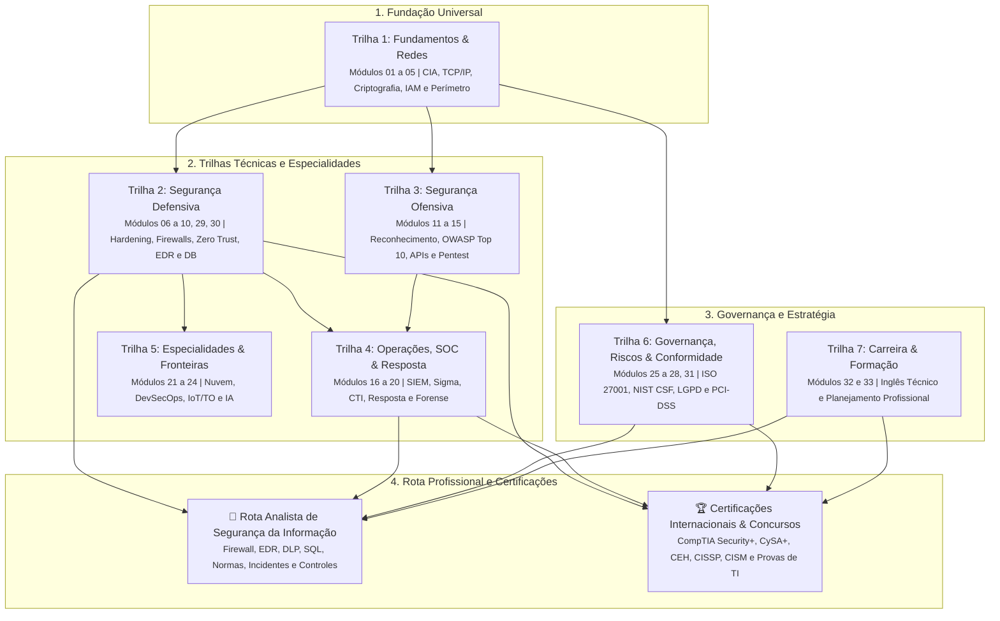
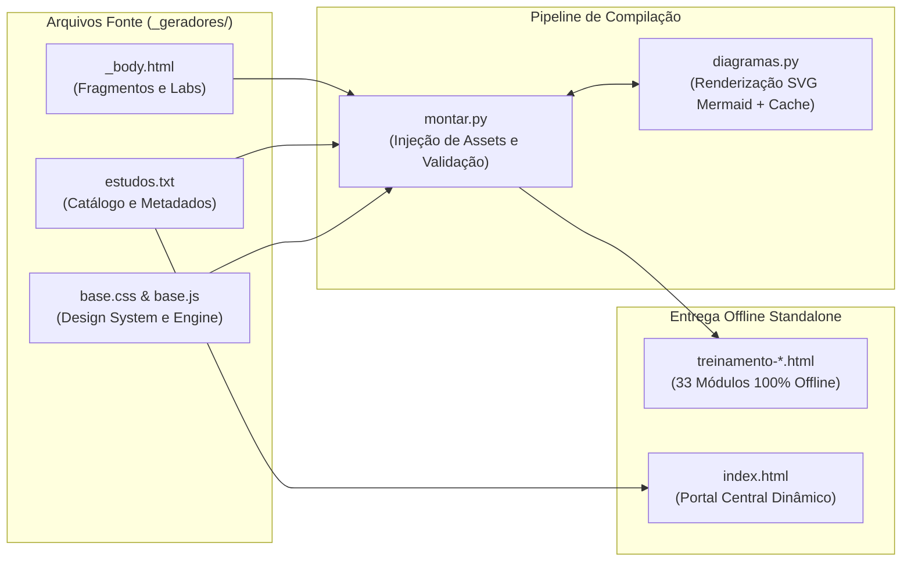

# Estudos de Cibersegurança

> Plataforma autoinstrucional, prática e enciclopédica sobre segurança da informação, defesa cibernética e governança corporativa, estruturada em **33 módulos temáticos** organizados em **7 trilhas estruturantes**.

---

## 🎯 Visão Geral do Projeto

O projeto **Estudos de Cibersegurança** foi desenvolvido para oferecer uma trilha de aprendizagem moderna, prática e rigorosa, voltada a estudantes de tecnologia, analistas e engenheiros de segurança (Blue Team, Red Team, AppSec, SOC e GRC), bem como a candidatos a certificações técnicas internacionais (**CompTIA Security+**, **CySA+**, **PenTest+**, **CEH**, **CISSP**) e concursos públicos de TI (**FGV**, **Cebraspe**, **FCC**, etc.).

### Pilares Fundamentais

1. **Zero Dependências Pesadas:**
   - Não requer servidores locais, containers Docker, bancos de dados ou dependências externas como LibreOffice (`soffice`).
2. **100% Offline e Standalone:**
   - Cada módulo compila em um único arquivo HTML5 autocontido, com Design System CSS e utilitários JavaScript totalmente embutidos (*inlined*). Funciona instantaneamente em qualquer navegador, mesmo sem conexão à internet.
3. **Interatividade Prática em Cada Módulo:**
   - Teoria pragmática e direta ao ponto (sem jargões desnecessários).
   - **Simuladores práticos em JavaScript Vanilla:** ferramentas interativas reais (analisadores de regras, decodificadores JWT, laboratórios de criptografia, calculadoras CVSS e terminais simulados).
   - **Checklists operacionais:** salvamento automático de progresso em `localStorage`.
   - **Quizzes de fixação:** perguntas comentadas com fundamentação técnica e normativa.
4. **Duplo Mapeamento Normativo:**
   - **NIST Cybersecurity Framework (CSF) 2.0:** categorização formal por funções (*Govern*, *Identify*, *Protect*, *Detect*, *Respond*, *Recover*).
   - **MITRE ATT&CK Matrix:** táticas e técnicas reais de ameaças contemporâneas.

---

## 🚀 Como Começar

Para acessar o material imediatamente, basta abrir o portal central:

```bash
# Abra diretamente no seu navegador preferido (Linux, macOS ou Windows):
xdg-open index.html          # No Linux
# ou abra 'index.html' pelo seu gerenciador de arquivos / navegador
```

O portal `index.html` conta com:
- **Estatísticas em Tempo Real:** contagem de módulos disponíveis, horas estimadas e progresso individual de conclusão gravado no navegador.
- **Filtros Dinâmicos:** visualização por trilha temática, perfil profissional (Blue Team, Red Team, AppSec, GRC, Cloud/DevSecOps, Analista de Segurança da Informação) e função do NIST CSF 2.0.
- **Matriz "Escolha pela Necessidade":** atalhos para os módulos com base em problemas práticos reais do dia a dia corporativo.
- **Busca Instantânea:** pesquisa rápida por título, termos técnicos ou conceitos-chave.

---

## 📚 Grade Curricular dos 33 Módulos

### Estrutura das Trilhas e Percurso Formativo



| # | Slug / Pasta | Título do Estudo | Trilha Temática | Função NIST CSF 2.0 | Simulador Interativo em JavaScript |
|:---:|---|---|---|:---:|---|
| **01** | `Fundamentos-Ciber` | Tríade CIA, Ameaças e Modelagem STRIDE | Trilha 1: Fundamentos & Redes | Identify | STRIDE Threat Canvas interativo |
| **02** | `Redes-e-Protocolos` | TCP/IP, DNS, Roteamento e Inspeção de Tráfego | Trilha 1: Fundamentos & Redes | Protect / Detect | Inspetor visual de cabeçalhos IP/TCP/UDP |
| **03** | `Criptografia-Pratica` | Criptografia Simétrica, Assimétrica, Hashes e PKI | Trilha 1: Fundamentos & Redes | Protect | Lab de Cifras (Web Crypto API SHA-256 + AES) |
| **04** | `Autenticacao-e-IAM` | Senhas, MFA, OAuth 2.0, Tokens JWT e RBAC | Trilha 1: Fundamentos & Redes | Protect | Validador/Decodificador JWT + Teste de RBAC |
| **05** | `Segmentacao-e-Firewall` | DMZ, VLANs, Regras de Firewall e Filtragem | Trilha 1: Fundamentos & Redes | Protect | Simulador de Regras de Firewall (Pass/Drop) |
| **06** | `Hardening-Sistemas` | Bastionamento Linux e Windows (CIS Benchmarks) | Trilha 2: Segurança Defensiva | Protect | Auditor interativo de configurações (`/etc/ssh`, etc.) |
| **07** | `Seguranca-de-Redes-Defesa` | IDS/IPS, WAF, VPNs e Proxies Reversos | Trilha 2: Segurança Defensiva | Protect / Detect | Analisador de regras Snort/Suricata vs Tráfego |
| **08** | `Arquitetura-Zero-Trust` | Princípios Zero Trust e Microsegmentação | Trilha 2: Segurança Defensiva | Protect | Motor de Decisão de Acesso Zero Trust |
| **09** | `Gestao-de-Vulnerabilidades` | CVE, CVSS v3.1/v4.0 e Priorização de Patches | Trilha 2: Segurança Defensiva | Identify / Protect | Calculadora interativa de Score CVSS v3.1/v4.0 |
| **10** | `Seguranca-em-Endpoints-EDR` | Antivírus, EDR/XDR e Proteção de Host | Trilha 2: Segurança Defensiva | Protect / Detect | Linha do tempo de telemetria e detecção EDR |
| **11** | `Reconhecimento-e-OSINT` | Superfície de Ataque, DNS, WHOIS e Shodan | Trilha 3: Segurança Ofensiva | Identify | Terminal simulado de OSINT e enumeração |
| **12** | `OWASP-Top-10-Web` | Falhas Web (SQLi, XSS, CSRF, Broken Auth) | Trilha 3: Segurança Ofensiva | Protect | Playground de injeção e sanitização web |
| **13** | `Seguranca-em-APIs` | OWASP API Security, Rate Limiting e Tokens | Trilha 3: Segurança Ofensiva | Protect | Simulador de chamadas de API com Rate Limiter |
| **14** | `Pentest-Metodologias` | Fases do Pentest (PTES), Escopo e Relatório | Trilha 3: Segurança Ofensiva | Identify | Construtor de matriz de achados e relatórios |
| **15** | `Engenharia-Social-e-Phishing` | Pretexting, Spear Phishing e Defesas Humanas | Trilha 3: Segurança Ofensiva | Protect | Analisador de e-mails suspeitos (Spot the Indicators) |
| **16** | `Operacoes-SOC-e-SIEM` | Rotina de SOC L1/L2, Logs e Regras Sigma | Trilha 4: Operações & SOC | Detect | Console SIEM com busca de logs e alertas |
| **17** | `Threat-Intelligence` | IoCs, TTPs, MITRE ATT&CK e STIX/TAXII | Trilha 4: Operações & SOC | Identify / Detect | Mapeador de IoCs e TTPs na matriz ATT&CK |
| **18** | `Resposta-a-Incidentes` | Ciclo NIST SP 800-61 Rev. 2 e Rev. 3 (Contenção e Erradicação) | Trilha 4: Operações & SOC | Respond | Runbook interativo em árvore de decisão |
| **19** | `Forense-Digital` | Cadeia de Custódia, Coleta de RAM e Artefatos | Trilha 4: Operações & SOC | Respond | Analisador de timeline de evidências e logs |
| **20** | `Analise-Basica-de-Malware` | Análise Estática vs Dinâmica e Sandboxes | Trilha 4: Operações & SOC | Detect / Respond | Inspetor de metadados PE/ELF e hashes |
| **21** | `Seguranca-em-Nuvem` | Responsabilidade Compartilhada e CSPM | Trilha 5: Especialidades | Protect | Auditor de permissões S3 e políticas IAM Cloud |
| **22** | `DevSecOps-e-CI-CD` | Shift-Left, SAST, DAST, SCA e Containers | Trilha 5: Especialidades | Protect | Simulador de pipeline CI/CD com security gates |
| **23** | `Seguranca-em-IoT-e-OT` | Redes Industriais (SCADA/Modbus) e IoT | Trilha 5: Especialidades | Protect | Mapeador do Modelo Purdue (TI vs TO) |
| **24** | `IA-e-Ciberseguranca` | Ameaças a LLMs (OWASP LLM), Deepfakes e Defesa | Trilha 5: Especialidades | Protect / Detect | Lab de Prompt Injection e defesas |
| **25** | `Gestao-de-Riscos-TI` | ISO 31000 e Avaliação Qualitativa vs Quantitativa (ALE/SLE) | Trilha 6: Governança & Riscos | Govern / Identify | Calculadora de matriz 5x5 e risco financeiro |
| **26** | `ISO-27001-e-27002` | SGSI, Anexo A, CIS Controls e NIST 800-53 | Trilha 6: Governança & Riscos | Govern | Matriz de Controles e Declaração de Aplicabilidade |
| **27** | `LGPD-e-Privacidade` | Bases Legais, Direitos do Titular e RIPD/DPIA | Trilha 6: Governança & Riscos | Govern / Protect | Construtor de Avaliação de Impacto (RIPD) |
| **28** | `Continuidade-e-Disaster-Recovery` | BCP, DRP, Cálculo de RTO/RPO e Regra 3-2-1 | Trilha 6: Governança & Riscos | Recover | Calculadora de RTO/RPO e estratégia 3-2-1 |
| **29** | `Protecao-de-Dados-e-Conteudo` | DLP, AntiSpam e Filtro de Conteúdo | Trilha 2: Segurança Defensiva | Protect / Detect | Gateway de Conteúdo |
| **30** | `Seguranca-de-Bancos-de-Dados` | Bancos de Dados Relacionais: SQL, Privilégios e Auditoria | Trilha 2: Segurança Defensiva | Protect / Detect | Matriz GRANT/REVOKE |
| **31** | `PCI-DSS` | PCI DSS v4.0.1: Escopo CDE e os 12 Requisitos | Trilha 6: Governança & Riscos | Govern / Protect | Delimitador de Escopo CDE |
| **32** | `Ingles-Tecnico-Ciber` | Inglês Técnico para Segurança da Informação | Trilha 7: Carreira & Formação | Protect | Leitor de Advisory |
| **33** | `Certificacoes-e-Carreira` | Formação, Certificações e Carreira | Trilha 7: Carreira & Formação | Protect | Planejador de Certificações |

---

## 🎯 Rota por Vaga: Analista de Segurança da Informação

O portal (`index.html`) traz a seção **Rota por Vaga**, que liga cada requisito de uma vaga de Analista de Segurança da Informação aos módulos que o cobrem (principais e de apoio):

| Competência da vaga | Módulos principais | Módulos de apoio |
|---|---|---|
| Soluções de Cyber Security (Firewalls, Antivírus, DLP, AntiSpam, WAF, Filtro de conteúdo) | 05, 07, 10, 29 | 15 |
| Banco de dados relacionais | 30 | 12 |
| Inglês | 32 | — |
| PCI-DSS, ISO 27001/27002, ISO 31000 e NIST | 25, 26, 31 | 18 |
| Resposta a incidentes | 18 | 16, 19 |
| Controles de segurança da informação | 26 | 06, 08 |
| Formação e certificações | 33 | — |

O portal também exibe a **Matriz de Certificações** (CEH, CISM, CISSP, CCSP, GSEC e Security+), com os módulos que cobrem cada uma.

---

## 🛠️ Como o Material é Gerado

A plataforma utiliza um pipeline de compilação em Python puro e Shell Script, localizado na pasta `_geradores/`.

### Fluxo do Pipeline de Compilação



### Estrutura do Pipeline

- `_geradores/estudos.txt`: Catálogo canônico dos 33 estudos com metadados estruturais (slug, título, pasta, arquivo HTML, número da trilha, cor do tema e função NIST CSF 2.0).
- `_geradores/CURRICULO.md`: Matriz pedagógica detalhada com competências, pré-requisitos e especificações de cada simulador interativo.
- `_geradores/GUIA-DO-AUTOR.md`: Manual editorial e técnico para criação de novos módulos ou expansão de conteúdo.
- `_geradores/base.css` e `_geradores/base.js`: Design System responsivo com suporte a temas claro e escuro, além de controladores de quizzes, checklists e utilitários de simulação.
- `_geradores/montar.py`: Compilador que processa fragmentos HTML (`*_body.html`) e injeta os assets necessários, gerando treinamentos autossuficientes.
- `_geradores/index_dados.py` & `_geradores/build_index.py`: Motor de compilação do portal mestre `index.html`.
- `_geradores/gerar.sh`: Script CLI mestre para execução ágil das rotinas de compilação.

### Comandos do CLI (`_geradores/gerar.sh`)

O script `_geradores/gerar.sh` é o ponto de entrada para desenvolvimento e manutenção:

```bash
# 1. Regenerar apenas o portal raiz (index.html):
./_geradores/gerar.sh portal

# 2. Compilar todos os módulos disponíveis e atualizar o portal index.html:
./_geradores/gerar.sh todos

# 3. Compilar um módulo específico e atualizar o portal index.html:
./_geradores/gerar.sh Fundamentos-Ciber
# ou
./_geradores/gerar.sh redes_e_protocolos

# 4. Exibir o menu de ajuda com todos os comandos:
./_geradores/gerar.sh help
```

### Execução dos Testes Automatizados

O repositório inclui uma suíte abrangente de testes automatizados com `unittest`:

```bash
# Executa todos os testes do pipeline:
python3 -m unittest discover -s _geradores/testes -v
```

---

## 🧭 Perfis de Carreira Atendidos

O currículo é estruturado de forma a atender diferentes objetivos e momentos de carreira:

- **Blue Team & Defesa Ativa:** Módulos de redes, bastionamento Linux/Windows, firewalls, Zero Trust, EDR e detecção de ameaças.
- **Red Team & Testes de Invasão:** Técnicas de reconhecimento OSINT, OWASP Top 10 Web, segurança de APIs e metodologias de pentest.
- **Operações, SOC & Forense:** Análise de logs SIEM, regras Sigma, inteligência de ameaças (CTI), resposta a incidentes e análise básica de malware.
- **Engenharia de Nuvem & DevSecOps:** Segurança em provedores cloud (AWS/Azure/GCP), pipelines CI/CD seguros, conteinerização e IoT/TO.
- **Governança, Riscos e Conformidade (GRC):** Metodologias de avaliação de risco (ALE/SLE), ISO/IEC 27001/27002:2022, LGPD e planos de continuidade/DRP.
- **Analista de Segurança da Informação:** Perfil generalista de vaga corporativa: soluções de segurança (firewall, EDR, DLP), bancos de dados, normas (PCI-DSS, ISO 27001/27002/31000, NIST), controles, resposta a incidentes, inglês técnico e certificações.

---

## 👤 Autor e Créditos

- **Autor:** José Mauro da Silva Stelling
- **Metodologia de Engenharia:** Superpowers Spec-Driven Development (SDD)
- **Idioma:** Português do Brasil (pt-BR)
- **Licença:** Material de uso pessoal, educacional e profissional.
