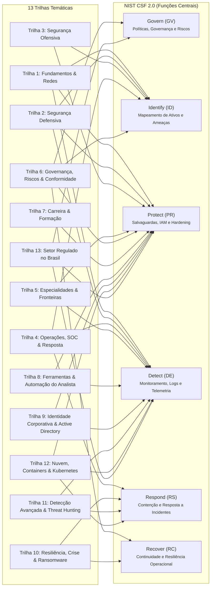

# Matriz Curricular: Estudos de Cibersegurança

## 1. Visão Geral e Filosofia Pedagógica

O currículo de **Estudos de Cibersegurança** foi concebido como uma formação autoinstrucional, prática e modular, dividida em **57 módulos temáticos** organizados em **13 trilhas estruturantes**. 

O projeto segue quatro diretrizes fundamentais:
1. **Teoria Pragmática e Direta ao Ponto:** Eliminação de floreios acadêmicos desnecessários; foco no que engenheiros, analistas e auditores de segurança executam na rotina corporativa e no que bancas de concursos e certificações (CompTIA Security+, CySA+, PenTest+, CEH, CISSP) cobram.
2. **Interatividade 100% Offline e Standalone:** Cada módulo consolida sua teoria com checklists gravados localmente (`localStorage`), quizzes de fixação comentados e **simuladores práticos em JavaScript puro (Vanilla JS)** executáveis diretamente no navegador sem servidores backend nem dependências pesadas.
3. **Duplo Mapeamento Normativo:** Integração orgânica entre a pedagogia por trilhas temáticas e os frameworks internacionais:
   - **NIST Cybersecurity Framework (CSF) 2.0:** Govern, Identify, Protect, Detect, Respond, Recover.
   - **MITRE ATT&CK Matrix:** Táticas e técnicas reais de adversários cibernéticos.
4. **Alinhamento a Perfis de Carreira:** Blue Team / Defesa, Red Team / Pentest, Engenharia de Nuvem & DevSecOps, Resposta a Incidentes / SOC, Governança, Risco e Conformidade (GRC) e Analista de Segurança da Informação (perfil generalista de vaga corporativa).

---

## 2. Mapa das 13 Trilhas Temáticas

A matriz pedagógica conecta diretamente as 13 trilhas estruturantes aos 6 pilares de governança e operação técnica preconizados pelo **NIST CSF 2.0**:

| Trilha | Denominação | Cor do Tema | Foco Técnico | Módulos |
|---|---|---|---|---|
| **Trilha 1** | Fundamentos & Redes | `#2563EB` (Azul) | Base sólida: CIA, protocolos, criptografia, IAM e perímetro | 01 ao 05 |
| **Trilha 2** | Segurança Defensiva | `#059669` (Verde) | Bastionamento, defesas de rede, Zero Trust, vulnerabilidades e EDR | 06 ao 10, 29, 30 |
| **Trilha 3** | Segurança Ofensiva | `#DC2626` (Vermelho) | Reconhecimento, falhas web, APIs, testes de intrusão e phishing | 11 ao 15 |
| **Trilha 4** | Operações, SOC & Resposta | `#7C3AED` (Roxo) | Monitoramento, SIEM, CTI, contenção de incidentes e forense | 16 ao 20 |
| **Trilha 5** | Especialidades & Fronteiras | `#0891B2` (Ciano) | Nuvem pública, DevSecOps/CI-CD, IoT/TO (Purdue) e Inteligência Artificial | 21 ao 24 |
| **Trilha 6** | Governança, Riscos & Conformidade | `#D97706` (Âmbar) | Gestão de risco (ALE/SLE), ISO 27001/27002, LGPD e continuidade de negócios | 25 ao 28, 31 |
| **Trilha 7** | Carreira & Formação | `#DB2777` (Rosa) | Inglês técnico, formação acadêmica, certificações e preparação para vagas | 32 e 33 |
| **Trilha 8** | Ferramentas & Automação do Analista | `#475569` (Ardósia) | Base prática do analista: Linux e PowerShell para investigação, automação com Python e regex, laboratório doméstico e portfólio | 34 ao 37 |
| **Trilha 9** | Identidade Corporativa & Active Directory | `#4F46E5` (Índigo) | Identidade no ambiente corporativo: Active Directory, Kerberos, ataques e detecção no AD, acessos privilegiados (PAM) e Entra ID | 38 ao 41 |
| **Trilha 10** | Resiliência, Crise & Ransomware | `#C2410C` (Laranja) | Resiliência operacional: ransomware da prevenção à recuperação, gestão de crise, exercícios tabletop e backup imutável | 42 ao 45 |
| **Trilha 11** | Detecção Avançada & Threat Hunting | `#A21CAF` (Fúcsia) | Detecção além da rotina do SOC: engenharia de detecção, threat hunting, monitoramento de rede e automação de resposta com SOAR. | 46 ao 49 |
| **Trilha 12** | Nuvem, Containers & Kubernetes | `#0F766E` (Verde-azulado) | Segurança de nuvem nativa: containers, Kubernetes, infraestrutura como código e detecção e resposta a incidentes em nuvem. | 50 ao 53 |
| **Trilha 13** | Setor Regulado no Brasil | `#4D7C0F` (Verde-oliva) | Segurança no contexto brasileiro: regulação do setor financeiro, fraude em pagamentos e Pix, legislação penal e riscos de terceiros. | 54 ao 57 |

---

## 3. Detalhamento dos 57 Módulos de Aprendizagem

### Trilha 1: Fundamentos & Redes (`#2563EB`)

#### 01. Fundamentos-Ciber
- **Título:** Tríade CIA, Ameaças e Modelagem STRIDE
- **Função NIST CSF 2.0:** *Identify (ID)*
- **Tempo Estimado:** 40 minutos | **Carreiras:** Todas (Fundação Universal)
- **Objetivos de Aprendizagem:** Compreender os pilares da segurança (Confidencialidade, Integridade, Disponibilidade, Autenticidade, Não-repúdio); categorizar vetores de ameaça; aplicar a metodologia de modelagem de ameaças da Microsoft (STRIDE).
- **Pré-requisitos:** Nenhum.
- **Conceitos-Chave:** Confidencialidade vs Criptografia, Hashing vs Integridade, SLA vs Disponibilidade, Spoofing, Tampering, Repudiation, Information Disclosure, Denial of Service, Elevation of Privilege.
- **Simulador Interativo em JS:** *STRIDE Threat Canvas* — Quadro interativo onde o estudante seleciona componentes de um sistema (banco de dados, API, usuário, link de rede) e mapeia ameaças STRIDE correspondentes com controles mitigatórios sugeridos.

#### 02. Redes-e-Protocolos
- **Título:** TCP/IP, DNS, Roteamento e Inspeção de Tráfego
- **Função NIST CSF 2.0:** *Protect (PR) / Detect (DE)*
- **Tempo Estimado:** 50 minutos | **Carreiras:** Blue Team, Red Team, SOC
- **Objetivos de Aprendizagem:** Dominar a pilha TCP/IP (camadas 2 a 7); dissecar cabeçalhos IPv4/IPv6, TCP (flags SYN/ACK/FIN/RST) e UDP; analisar resoluções DNS e envenenamento de cache; compreender a estrutura de pacotes para análise forense e detecção de anomalias.
- **Pré-requisitos:** Fundamentos-Ciber.
- **Conceitos-Chave:** 3-Way Handshake, TCP Flags, TTL, DNS Recursivo vs Autoritativo, ARP Spoofing, MTU e fragmentação.
- **Simulador Interativo em JS:** *Inspetor Visual de Cabeçalhos IP/TCP/UDP* — Permite ao aluno manipular flags TCP, endereços e portas, visualizando os bytes brutos do cabeçalho e a reação simulada do host de destino (ex.: porta aberta SYN-ACK vs fechada RST-ACK).

#### 03. Criptografia-Pratica
- **Título:** Criptografia Simétrica, Assimétrica, Hashes e PKI
- **Função NIST CSF 2.0:** *Protect (PR)*
- **Tempo Estimado:** 45 minutos | **Carreiras:** Blue Team, AppSec, GRC
- **Objetivos de Aprendizagem:** Diferenciar cifras de bloco e de fluxo (AES vs ChaCha20); dominar troca de chaves Diffie-Hellman e RSA; entender funções de resumo criptográfico (SHA-256, HMAC); compreender a cadeia de confiança de Certificados Digitais X.509 e PKI.
- **Pré-requisitos:** Redes-e-Protocolos.
- **Conceitos-Chave:** AES-GCM, RSA-2048/4096, Curvas Elípticas (ECDSA, Ed25519), Salting, Hash Colisões, CA Raiz, CRL e OCSP Stapling.
- **Simulador Interativo em JS:** *Lab de Cifras (Web Crypto API)* — Gera chaves simétricas AES-GCM e resumos SHA-256 diretamente no navegador utilizando a API criptográfica nativa, demonstrando o efeito avalanche de hashes e decifrações com chave errada.

#### 04. Autenticacao-e-IAM
- **Título:** Senhas, MFA, OAuth 2.0, Tokens JWT e RBAC
- **Função NIST CSF 2.0:** *Protect (PR)*
- **Tempo Estimado:** 45 minutos | **Carreiras:** AppSec, Blue Team, Cloud/DevSecOps
- **Objetivos de Aprendizagem:** Projetar controles de identidade e controle de acesso; implementar autenticação multifator (TOTP/FIDO2); decodificar e validar tokens JSON Web Token (JWT); comparar RBAC (Role-Based) com ABAC (Attribute-Based).
- **Pré-requisitos:** Criptografia-Pratica.
- **Conceitos-Chave:** Hashing de senhas (Argon2, bcrypt), TOTP RFC 6238, FIDO2/WebAuthn, JWT Header/Payload/Signature, None Algorithm Attack, Principle of Least Privilege.
- **Simulador Interativo em JS:** *Validador e Decodificador JWT + Matriz RBAC* — Decodifica tokens JWT em tempo real, permite alterar claims e simular ataques de assinatura inválida ou algoritmo 'none', testando permissões de acesso em matriz de perfis RBAC.

#### 05. Segmentacao-e-Firewall
- **Título:** DMZ, VLANs, Regras de Firewall e Filtragem
- **Função NIST CSF 2.0:** *Protect (PR)*
- **Tempo Estimado:** 40 minutos | **Carreiras:** Blue Team, Engenharia de Redes
- **Objetivos de Aprendizagem:** Desenhar arquiteturas de rede seguras com zonas desmilitarizadas (DMZ) e VLANs (802.1Q); formular regras de firewall de filtragem de pacotes e stateful inspection; entender a ordem de precedência das regras (First-Match).
- **Pré-requisitos:** Redes-e-Protocolos.
- **Conceitos-Chave:** Stateful vs Stateless, Tabela de Estados Conntrack, Regra Default Drop, DMZ de dois estágios, Trunking 802.1Q e isolamento inter-VLAN.
- **Simulador Interativo em JS:** *Simulador de Regras de Firewall (Pass / Drop)* — Console interativo onde o aluno cadastra regras de firewall (ordem, IP origem/destino, porta, ação) e dispara pacotes de teste para visualizar qual regra capturou o pacote e a razão da decisão.

---

### Trilha 2: Segurança Defensiva (`#059669`)

#### 06. Hardening-Sistemas
- **Título:** Bastionamento Linux e Windows (CIS Benchmarks)
- **Função NIST CSF 2.0:** *Protect (PR)*
- **Tempo Estimado:** 50 minutos | **Carreiras:** Blue Team, SysAdmin, DevSecOps
- **Objetivos de Aprendizagem:** Aplicar diretrizes CIS Benchmarks em ambientes operacionais; desativar serviços e portas desnecessárias; configurar `/etc/ssh/sshd_config` restritivo, PAM, AppArmor/SELinux e Group Policies (GPO) do Windows.
- **Pré-requisitos:** Fundamentos-Ciber, Redes-e-Protocolos.
- **Conceitos-Chave:** CIS Level 1 e Level 2, Umask, Rootless containers, SSH Key-only + fail2ban, Windows Defender Exploit Guard, PowerShell Constrained Language Mode.
- **Simulador Interativo em JS:** *Auditor Interativo de Configuração de Servidor* — Analisa snippets de configuração de sistemas (`sshd_config`, `sysctl.conf`, `GPO`) e aponta vulnerabilidades em conformidade com as recomendações dos CIS Benchmarks.

#### 07. Seguranca-de-Redes-Defesa
- **Título:** IDS/IPS, WAF, VPNs e Proxies Reversos
- **Função NIST CSF 2.0:** *Protect (PR) / Detect (DE)*
- **Tempo Estimado:** 50 minutos | **Carreiras:** Blue Team, SOC, Engenharia de Redes
- **Objetivos de Aprendizagem:** Compreender a atuação de sistemas de detecção e prevenção de intrusão (Snort, Suricata); configurar Web Application Firewalls (ModSecurity, AWS WAF); estabelecer túneis VPN seguros (IPsec IKEv2, WireGuard, OpenVPN).
- **Pré-requisitos:** Segmentacao-e-Firewall.
- **Conceitos-Chave:** Assinaturas vs Anomalias heurísticas, PCRE em regras IDS, WAF Core Rule Set (CRS), MTLS em proxies reversos, WireGuard Noise Protocol.
- **Simulador Interativo em JS:** *Analisador de Regras Snort/Suricata vs Tráfego* — Mostra payloads de rede de teste sendo avaliados por uma lista de regras de IDS, demonstrando alertas gerados, extração de variáveis (`content`, `nocase`, `sid`) e mitigação.

#### 08. Arquitetura-Zero-Trust
- **Título:** Princípios Zero Trust e Microsegmentação
- **Função NIST CSF 2.0:** *Protect (PR)*
- **Tempo Estimado:** 40 minutos | **Carreiras:** Blue Team, Arquitetura de TI, GRC
- **Objetivos de Aprendizagem:** Dominar os 3 pilares NIST SP 800-207: "Never trust, always verify", "Assume breach" e "Verify explicitly"; implementar Policy Decision Points (PDP) e Policy Enforcement Points (PEP); planejar microsegmentação por workload.
- **Pré-requisitos:** Autenticacao-e-IAM, Segmentacao-e-Firewall.
- **Conceitos-Chave:** NIST SP 800-207, ZTNA (Zero Trust Network Access), Postura de Dispositivo (Device Health/Compliance), Context-aware Access, SDP (Software-Defined Perimeter).
- **Simulador Interativo em JS:** *Motor de Decisão de Acesso Zero Trust (PDP/PEP)* — O aluno define parâmetros de contexto (horário, IP da requisição, conformidade do dispositivo, cargo do usuário) e simula a pontuação de risco e a decisão de acesso (Permitir, Bloquear, Exigir MFA adicional).

#### 09. Gestao-de-Vulnerabilidades
- **Título:** CVE, CVSS v3.1/v4.0 e Priorização de Patches
- **Função NIST CSF 2.0:** *Identify (ID) / Protect (PR)*
- **Tempo Estimado:** 45 minutos | **Carreiras:** Blue Team, GRC, SOC
- **Objetivos de Aprendizagem:** Entender o ciclo de vida de vulnerabilidades (descoberta, atribuição de CVE, divulgação responsável); calcular scores CVSS v3.1 e entender novidades do CVSS v4.0; correlacionar CVSS com EPSS (Exploit Prediction Scoring System) e CISA KEV (Known Exploited Vulnerabilities).
- **Pré-requisitos:** Hardening-Sistemas.
- **Conceitos-Chave:** Base Score vs Temporal vs Environmental, Vetores de ataque (AV, AC, PR, UI, S, C, I, A), EPSS score, CISA KEV Catalog, SLA de correção por severidade.
- **Simulador Interativo em JS:** *Calculadora Interativa de Score CVSS v3.1 / v4.0* — Permite ao aluno selecionar métricas de ataque (Vetor de Ataque, Complexidade, Privilégios, Impacto) e calcula dinamicamente o score base de 0.0 a 10.0 com a string de vetor correspondente.

#### 10. Seguranca-em-Endpoints-EDR
- **Título:** Antivírus, EDR/XDR e Proteção de Host
- **Função NIST CSF 2.0:** *Protect (PR) / Detect (DE)*
- **Tempo Estimado:** 45 minutos | **Carreiras:** Blue Team, SOC, Incident Response
- **Objetivos de Aprendizagem:** Comparar antivírus tradicional baseado em assinatura com EDR (Endpoint Detection and Response) comportamental; compreender telemetria de host (Sysmon, Event ID do Windows, auditd no Linux); entender árvore de processos maliciosos (`parent-child`).
- **Pré-requisitos:** Hardening-Sistemas.
- **Conceitos-Chave:** Heurística e ML no host, Sysmon Event ID 1 (Process Create), Event ID 3 (Network Connect), Process Injection, LSASS dumping detecção, Isolamento de host em rede.
- **Simulador Interativo em JS:** *Linha do Tempo de Telemetria e Detecção EDR* — Simula eventos de um endpoint atacado (Office disparando PowerShell, conexão de rede externa, modificação de registro) e permite ao analista identificar anomalias e executar a ação de isolamento de host.

#### 29. Protecao-de-Dados-e-Conteudo
- **Título:** DLP, AntiSpam e Filtro de Conteúdo
- **Função NIST CSF 2.0:** *Protect (PR) / Detect (DE)*
- **Tempo Estimado:** 50 minutos | **Carreiras:** Blue Team, SOC, GRC, Analista de Segurança da Informação
- **Objetivos de Aprendizagem:** Diferenciar DLP de rede, de endpoint e de nuvem (CASB); construir detectores por padrão (regex), por checksum (Luhn) e por dicionário; explicar a autenticação de e-mail (SPF, DKIM, DMARC) e a filtragem antispam por reputação e conteúdo; configurar filtro de conteúdo e URL por categoria em proxy seguro (SWG).
- **Pré-requisitos:** Redes-e-Protocolos, Seguranca-de-Redes-Defesa.
- **Conceitos-Chave:** Dados em uso, em trânsito e em repouso, Classificação da informação, Falso positivo vs falso negativo em DLP, Quarentena, Políticas DMARC (`none`, `quarantine`, `reject`), SWG, Categorização de URL, Inspeção TLS.
- **Simulador Interativo em JS:** *Gateway de Conteúdo* — O aluno escolhe ou edita uma mensagem de e-mail ou um upload web de exemplo, que passa pelos estágios que se aplicam ao tipo de item: AntiSpam para e-mail recebido (SPF, DKIM, DMARC com alinhamento, reputação e pontuação de conteúdo), DLP para e-mail enviado e upload (detectores de CPF com dígito verificador, cartão de pagamento com Luhn e palavras-chave configuráveis) e Filtro de URL para links e destinos (bloqueio por categoria do domínio). São oito itens da Ipê Store, todos com domínios .example. O resultado final é Permitir, Quarentena ou Bloquear, com a justificativa de cada estágio, e o aluno pode alterar políticas e limiares e reprocessar.

#### 30. Seguranca-de-Bancos-de-Dados
- **Título:** Bancos de Dados Relacionais: SQL, Privilégios e Auditoria
- **Função NIST CSF 2.0:** *Protect (PR) / Detect (DE)*
- **Tempo Estimado:** 50 minutos | **Carreiras:** Blue Team, AppSec, GRC, Analista de Segurança da Informação
- **Objetivos de Aprendizagem:** Revisar o modelo relacional (tabelas, chaves, JOIN, normalização) e SQL DDL/DML/DCL; aplicar menor privilégio com roles, `GRANT`/`REVOKE`, views e Row-Level Security; configurar auditoria de banco; proteger dados com TDE, criptografia de coluna, mascaramento dinâmico e backups cifrados; prevenir SQLi com prepared statements.
- **Pré-requisitos:** Autenticacao-e-IAM, Criptografia-Pratica.
- **Conceitos-Chave:** ACID, DDL vs DML vs DCL, Roles e esquemas, RLS, TDE, Dynamic Data Masking, Auditoria nativa (pgAudit, SQL Server Audit), Database Activity Monitoring (DAM), Contas de serviço, Hardening de SGBD (CIS Benchmarks para PostgreSQL, MySQL e SQL Server).
- **Simulador Interativo em JS:** *Matriz GRANT/REVOKE* — Um esquema fictício com 3 a 4 tabelas, roles e usuários. O aluno concede e revoga privilégios (`SELECT`, `INSERT`, `UPDATE`, `DELETE`) por role e tabela e então executa uma lista de consultas de usuários fictícios. Cada consulta é marcada como permitida ou negada, gera uma entrada na trilha de auditoria e, quando houver mascaramento ativo, mostra o valor mascarado.

---

### Trilha 3: Segurança Ofensiva (`#DC2626`)

#### 11. Reconhecimento-e-OSINT
- **Título:** Superfície de Ataque, DNS, WHOIS e Shodan
- **Função NIST CSF 2.0:** *Identify (ID)*
- **Tempo Estimado:** 45 minutos | **Carreiras:** Red Team, Threat Intelligence
- **Objetivos de Aprendizagem:** Mapear a superfície de ataque externa de uma organização usando inteligência de fontes abertas (OSINT); consultar registros DNS, WHOIS, certificados SSL (Certificate Transparency Logs); pesquisar ativos expostos em Shodan e Censys de forma ética.
- **Pré-requisitos:** Redes-e-Protocolos.
- **Conceitos-Chave:** Reconhecimento passivo vs ativo, Dorks do Google, Subdomain Takeover, Shodan dorks (`org:`, `port:`, `vuln:`), Metadados em documentos (ExifTool).
- **Simulador Interativo em JS:** *Terminal Simulado de OSINT e Enumeração* — Terminal interativo com comandos simulados (`whois`, `dig`, `crtsh`, `shodan_search`) para mapear alvos corporativos fictícios e descobrir subdomínios e portas desprotegidas.

#### 12. OWASP-Top-10-Web
- **Título:** Falhas Web (SQLi, XSS, CSRF, Broken Auth)
- **Função NIST CSF 2.0:** *Protect (PR)*
- **Tempo Estimado:** 55 minutos | **Carreiras:** AppSec, Red Team, Desenvolvedores
- **Objetivos de Aprendizagem:** Identificar e mitigar as principais vulnerabilidades em aplicações web de acordo com a lista oficial da OWASP; entender injeções SQL (clássica, cega, baseada em tempo); dominar cross-site scripting (Reflected, Stored, DOM); prevenir broken object level authorization (BOLA) e CSRF.
- **Pré-requisitos:** Autenticacao-e-IAM.
- **Conceitos-Chave:** OWASP Top 10 A01-A10, Prepared Statements / Parametrização, Content Security Policy (CSP), SameSite Cookies, Sanitização vs Encoding de saída.
- **Simulador Interativo em JS:** *Playground de Injeção e Sanitização Web* — Interface com campos vulneráveis (busca vulnerável a SQLi, comentários com XSS) onde o aluno digita payloads de teste, observa o impacto no DOM ou na query simulada, e ativa filtros sanitizadores para validar a correção.

#### 13. Seguranca-em-APIs
- **Título:** OWASP API Security, Rate Limiting e Tokens
- **Função NIST CSF 2.0:** *Protect (PR)*
- **Tempo Estimado:** 40 minutos | **Carreiras:** AppSec, DevSecOps, Backend Devs
- **Objetivos de Aprendizagem:** Analisar os 10 riscos críticos em APIs (OWASP API Security Top 10); proteger endpoints contra Broken Object Level Authorization (BOLA/IDOR); implementar algoritmos de rate limiting (Token Bucket, Leaky Bucket); validar esquemas e payloads JSON.
- **Pré-requisitos:** Autenticacao-e-IAM, OWASP-Top-10-Web.
- **Conceitos-Chave:** API1:2023 Broken Object Level Authorization, API2 Broken Authentication, Token Bucket Algorithm, API Gateways, Mass Assignment, GraphQL vs REST Security.
- **Simulador Interativo em JS:** *Simulador de Chamadas de API com Rate Limiter* — Permite disparar requisições para endpoints REST simulados, configurando headers de autorização e observando o bloqueio por HTTP 429 (Too Many Requests) e HTTP 403 por quebra de BOLA.

#### 14. Pentest-Metodologias
- **Título:** Fases do Pentest (PTES), Escopo e Relatório
- **Função NIST CSF 2.0:** *Identify (ID)*
- **Tempo Estimado:** 45 minutos | **Carreiras:** Red Team, Auditores, Consultores
- **Objetivos de Aprendizagem:** Compreender as fases formais do teste de invasão segundo o PTES (Pre-engagement, Intelligence Gathering, Threat Modeling, Vulnerability Analysis, Exploitation, Post-Exploitation, Reporting); definir regras de engajamento (RoE); redigir relatórios executivos e técnicos com recomendações acionáveis.
- **Pré-requisitos:** Reconhecimento-e-OSINT, OWASP-Top-10-Web.
- **Conceitos-Chave:** White-box vs Gray-box vs Black-box, Scope Creep, Rules of Engagement (RoE), Matriz de Risco do Achado, Sumário Executivo vs Detalhes de Reprodução Técnica.
- **Simulador Interativo em JS:** *Construtor de Matriz de Achados e Relatórios de Pentest* — Ferramenta onde o estudante cadastra vulnerabilidades encontradas durante um teste hipotético, atribui severidade e gera automaticamente a matriz de risco e a minuta de relatório executivo formatado.

#### 15. Engenharia-Social-e-Phishing
- **Título:** Pretexting, Spear Phishing e Defesas Humanas
- **Função NIST CSF 2.0:** *Protect (PR)*
- **Tempo Estimado:** 40 minutos | **Carreiras:** Red Team, Blue Team, Conscientização
- **Objetivos de Aprendizagem:** Reconhecer táticas psicológicas de engenharia social (urgência, autoridade, escassez, prova social); diferenciar phishing em massa de spear phishing e whaling; validar autenticação de e-mail (SPF, DKIM, DMARC); estruturar programas corporativos de conscientização e simulação controlada.
- **Pré-requisitos:** Fundamentos-Ciber.
- **Conceitos-Chave:** Pretexting, Vishing, Smishing, Typosquatting em domínios, SPF (`v=spf1`), DKIM selector e assinatura criptográfica, DMARC política (`p=reject`), Chaves de segurança física anti-phishing (FIDO2).
- **Simulador Interativo em JS:** *Analisador de E-mails Suspeitos (Spot the Indicators)* — Apresenta e-mails simulados na interface com cabeçalhos brutos e corpo visual; o estudante deve inspecionar e clicar nos indicadores de comprometimento (erros no cabeçalho `Return-Path`, links divergentes, spoofing de remetente, urgência forçada).

---

### Trilha 4: Operações, SOC & Resposta (`#7C3AED`)

#### 16. Operacoes-SOC-e-SIEM
- **Título:** Rotina de SOC L1/L2, Logs e Regras Sigma
- **Função NIST CSF 2.0:** *Detect (DE)*
- **Tempo Estimado:** 50 minutos | **Carreiras:** SOC Analyst, Blue Team
- **Objetivos de Aprendizagem:** Entender a operação de um Centro de Operações de Segurança (SOC); diferenciar níveis de suporte (N1 triagem, N2 investigação, N3 caça a ameaças); configurar ingestão e parsing de logs em SIEM (Elastic, Splunk); escrever e interpretar regras de detecção padronizadas no formato Sigma.
- **Pré-requisitos:** Hardening-Sistemas, Seguranca-em-Endpoints-EDR.
- **Conceitos-Chave:** MTTD (Mean Time to Detect), MTTR (Mean Time to Respond), Falsos Positivos vs Falsos Negativos, Normalização CEF/LEEF/ECS, Estrutura de regra Sigma (title, logsource, detection, condition).
- **Simulador Interativo em JS:** *Console SIEM com Busca de Logs e Alertas* — Painel com fluxo de eventos em tempo real onde o analista executa queries simuladas estilo KQL/Splunk e testa regras Sigma contra a base de logs para disparar alertas de segurança.

#### 17. Threat-Intelligence
- **Título:** IoCs, TTPs, MITRE ATT&CK e STIX/TAXII
- **Função NIST CSF 2.0:** *Identify (ID) / Detect (DE)*
- **Tempo Estimado:** 45 minutos | **Carreiras:** Threat Intel Analyst, SOC, Blue Team
- **Objetivos de Aprendizagem:** Aplicar a Pirâmide da Dor de David Bianco; diferenciar Indicadores de Comprometimento (IoCs) voláteis de Táticas, Técnicas e Procedimentos (TTPs) persistentes; navegar pela matriz MITRE ATT&CK para Enterprise; compreender os padrões de troca de inteligência STIX 2.1 e TAXII.
- **Pré-requisitos:** Operacoes-SOC-e-SIEM.
- **Conceitos-Chave:** Pyramid of Pain (Hash, IP, Domínio, Artefato, Ferramenta, TTP), ATT&CK Táticas (TA0001 a TA0040), Técnicas e Subtécnicas (T1059.001), STIX Objetos (Indicator, Threat Actor, Malware, Relationship), TAXII Collections.
- **Simulador Interativo em JS:** *Mapeador de IoCs e TTPs na Matriz ATT&CK* — Permite ao analista colar relatórios de inteligência, extrair IoCs e relacionar técnicas descritas às colunas da matriz MITRE ATT&CK, gerando mapa visual de calor de táticas do adversário.

#### 18. Resposta-a-Incidentes
- **Título:** Ciclo NIST SP 800-61 Rev. 2 e Rev. 3 (Contenção e Erradicação)
- **Função NIST CSF 2.0:** *Respond (RS)*
- **Tempo Estimado:** 50 minutos | **Carreiras:** Incident Responder, SOC N2/N3, Gestores
- **Objetivos de Aprendizagem:** Executar as 4 etapas do ciclo de incidentes do NIST SP 800-61 Rev 2: 1. Preparação, 2. Detecção & Análise, 3. Contenção, Erradicação & Recuperação, 4. Atividades Pós-Incidente (Lições Aprendidas); elaborar playbooks de resposta; gerenciar comunicação com stakeholders e órgãos reguladores; conhecer a NIST SP 800-61 Rev. 3 (2025), que reorganiza a resposta a incidentes segundo as funções do CSF 2.0, ao lado do ciclo clássico da Rev. 2.
- **Pré-requisitos:** Operacoes-SOC-e-SIEM.
- **Conceitos-Chave:** Contenção de curto vs longo prazo, Preservação de evidências voláteis antes do reboot, Erradicação de persistência de malware, Post-Mortem / Retrospectiva sem culpados (Blameless), NIST SP 800-61 Rev. 3 e funções do CSF 2.0.
- **Simulador Interativo em JS:** *Runbook Interativo em Árvore de Decisão* — Dois cenários à escolha do aluno: ransomware em progressão no servidor de arquivos e vazamento de banco de dados por credencial comprometida. Em cada um, o aluno toma 8 decisões; cada opção mostra a fase da Rev. 2 e a função da Rev. 3, avança o cronômetro de impacto no negócio e pode destruir evidências ou permitir propagação. O final traz pontuação, fases percorridas e comentários sobre as decisões a revisar.

#### 19. Forense-Digital
- **Título:** Cadeia de Custódia, Coleta de RAM e Artefatos
- **Função NIST CSF 2.0:** *Respond (RS)*
- **Tempo Estimado:** 45 minutos | **Carreiras:** Perito Forense, Incident Response, Jurídico
- **Objetivos de Aprendizagem:** Preservar a cadeia de custódia segundo a ISO/IEC 27037; respeitar a ordem de volatilidade de evidências digitais (RFC 3227); coletar cópias bit-a-bit com bloqueadores de escrita e conferência de hashes; extrair e analisar artefatos do Windows (Prefetch, Amcache, Shimcache, LNK, $MFT, Registro).
- **Pré-requisitos:** Hardening-Sistemas, Resposta-a-Incidentes.
- **Conceitos-Chave:** ISO/IEC 27037, RFC 3227 Ordem de Volatilidade (RAM, Swap, Disco, Logs remotos), Hashes de integridade (SHA-256), Write Blocker de hardware/software, Timeline Analysis (Super-timeline com Plaso).
- **Simulador Interativo em JS:** *Analisador de Timeline de Evidências e Logs Forenses* — Permite carregar e inspecionar linhas do tempo simuladas de eventos de múltiplos artefatos (criação de arquivos, execuções de Prefetch, conexões de rede), ordenando cronologicamente as ações de um invasor.

#### 20. Analise-Basica-de-Malware
- **Título:** Análise Estática vs Dinâmica e Sandboxes
- **Função NIST CSF 2.0:** *Detect (DE) / Respond (RS)*
- **Tempo Estimado:** 45 minutos | **Carreiras:** Malware Analyst, SOC N3, Incident Response
- **Objetivos de Aprendizagem:** Diferenciar análise de malware estática (sem execução) de dinâmica (em ambiente isolado); inspecionar cabeçalhos de arquivos executáveis (PE no Windows, ELF no Linux); extrair strings e funções importadas (IAT); interpretar relatórios de sandboxes automatizadas (Cuckoo, CAPEv2).
- **Pré-requisitos:** Criptografia-Pratica, Hardening-Sistemas.
- **Conceitos-Chave:** Hashes de arquivo (MD5, SHA-256, SSDEEP para fuzzy hashing), Seções do PE (.text, .data, .rsrc), Entropia de Shannon (detecção de packers/crypters), Imports maliciosos comuns (`VirtualAllocEx`, `WriteProcessMemory`, `CreateRemoteThread`).
- **Simulador Interativo em JS:** *Inspetor de Metadados PE/ELF e Hashes* — Analisador interativo que desmonta um arquivo binário simulado, exibindo seções, cálculo de entropia com indicação de empacotamento (UPX) e lista de chamadas da API do Windows para classificar a intenção do arquivo.

---

### Trilha 5: Especialidades & Fronteiras (`#0891B2`)

#### 21. Seguranca-em-Nuvem
- **Título:** Responsabilidade Compartilhada e CSPM
- **Função NIST CSF 2.0:** *Protect (PR)*
- **Tempo Estimado:** 45 minutos | **Carreiras:** Cloud Security Engineer, DevSecOps, Arquitetura
- **Objetivos de Aprendizagem:** Dominar o Modelo de Responsabilidade Compartilhada em IaaS, PaaS e SaaS nos provedores AWS, Azure e GCP; auditar e endurecer políticas de IAM e permissões em nuvem (Least Privilege); proteger buckets de armazenamento contra vazamentos públicos; entender ferramentas de CSPM (Cloud Security Posture Management) e CWPP.
- **Pré-requisitos:** Autenticacao-e-IAM, Hardening-Sistemas.
- **Conceitos-Chave:** Shared Responsibility Model, AWS IAM Policies (Effect, Principal, Action, Resource, Condition), Políticas de Bucket S3 (Block Public Access), Metadados de Instância (IMDSv2 vs SSRF), CIS Cloud Benchmarks.
- **Simulador Interativo em JS:** *Auditor de Permissões S3 e Políticas IAM Cloud* — Editor interativo de políticas JSON de nuvem onde o aluno avalia políticas de acesso e testa se a política permite ações perigosas (`s3:*`, `Principal: *`) ou atende aos princípios de mínimo privilégio.

#### 22. DevSecOps-e-CI-CD
- **Título:** Shift-Left, SAST, DAST, SCA e Containers
- **Função NIST CSF 2.0:** *Protect (PR)*
- **Tempo Estimado:** 45 minutos | **Carreiras:** DevSecOps, Engenharia de Software, AppSec
- **Objetivos de Aprendizagem:** Integrar segurança ao ciclo de vida de desenvolvimento (SSDLC / Shift-Left); posicionar ferramentas SAST (Static Analysis), DAST (Dynamic Analysis) e SCA (Software Composition Analysis) em pipelines CI/CD; aplicar boas práticas de segurança em Docker e Kubernetes (imagens enxutas, containers sem privilégios de root, assinatura com Sigstore/Cosign).
- **Pré-requisitos:** OWASP-Top-10-Web, Seguranca-em-APIs.
- **Conceitos-Chave:** Shift-Left Security, SAST vs DAST vs IAST, Vulnerabilidades em dependências (SCA, SBOM - CycloneDX/SPDX), Dockerfile seguro (`USER nonroot`, imagens distroless), Quality Gates de build.
- **Simulador Interativo em JS:** *Simulador de Pipeline CI/CD com Security Gates* — Interface que simula as etapas de uma esteira CI/CD (Lint, SAST, SCA, Testes, Deploy) com parametrização de thresholds de quebra de build baseados na gravidade de vulnerabilidades detectadas.

#### 23. Seguranca-em-IoT-e-OT
- **Título:** Redes Industriais (SCADA/Modbus) e IoT
- **Função NIST CSF 2.0:** *Protect (PR)*
- **Tempo Estimado:** 40 minutos | **Carreiras:** Segurança Industrial, Blue Team, Red Team
- **Objetivos de Aprendizagem:** Compreender a separação entre Tecnologia da Informação (TI) e Tecnologia da Operação (TO); navegar pelas camadas do Modelo Purdue para sistemas de controle industrial (ICS/SCADA); reconhecer a falta de autenticação e criptografia nativas em protocolos legados (Modbus, DNP3, BACnet); proteger dispositivos IoT com firmware seguro e isolamento de rede.
- **Pré-requisitos:** Redes-e-Protocolos, Segmentacao-e-Firewall.
- **Conceitos-Chave:** Modelo Purdue (Níveis 0 ao 5), SCADA vs CLP (PLC) vs IHM (HMI), Protocolo Modbus TCP (Porta 502), Ataques Stuxnet e Industroyer, Norma IEC 62443.
- **Simulador Interativo em JS:** *Mapeador do Modelo Purdue (TI vs TO)* — Diagrama arquitetural interativo onde o estudante posiciona sensores, PLCs, servidores SCADA, firewalls industriais e estações de trabalho nos níveis corretos do Modelo Purdue e visualiza regras de tráfego permitidas entre zonas.

#### 24. IA-e-Ciberseguranca
- **Título:** Ameaças a LLMs (OWASP LLM), Deepfakes e Defesa
- **Função NIST CSF 2.0:** *Protect (PR) / Detect (DE)*
- **Tempo Estimado:** 45 minutos | **Carreiras:** Engenheiros de IA, AppSec, Blue Team
- **Objetivos de Aprendizagem:** Identificar os 10 riscos críticos em aplicações de Inteligência Artificial Generativa segundo o OWASP Top 10 for LLM Applications; entender ataques de Prompt Injection (direto e indireto) e Data Poisoning; analisar o impacto de Deepfakes de áudio e vídeo na engenharia social; utilizar IA defensiva para triagem de alertas e análise preditiva.
- **Pré-requisitos:** Fundamentos-Ciber, OWASP-Top-10-Web.
- **Conceitos-Chave:** OWASP LLM01: Prompt Injection, LLM02: Sensitive Information Disclosure, LLM06: Excessive Agency, Guardrails de entrada e saída, Detecção de Deepfake, IA em operações defensivas.
- **Simulador Interativo em JS:** *Lab de Prompt Injection e Defesas* — Simula um chatbot de atendimento corporativo integrado a ferramentas internas. O aluno testa técnicas de injeção de prompt para tentar extrair segredos do sistema e depois ativa guardrails com regex e sanitização para bloquear o bypass.

---

### Trilha 6: Governança, Riscos & Conformidade (`#D97706`)

#### 25. Gestao-de-Riscos-TI
- **Título:** ISO 31000 e Avaliação Qualitativa vs Quantitativa (ALE/SLE)
- **Função NIST CSF 2.0:** *Govern (GV) / Identify (ID)*
- **Tempo Estimado:** 45 minutos | **Carreiras:** GRC, Auditores, CISO, Gestores
- **Objetivos de Aprendizagem:** Conduzir análises de risco qualitativas utilizando matrizes de probabilidade e impacto (5x5); dominar cálculos quantitativos de risco financeiro: Valor do Ativo (AV), Fator de Exposição (EF), Expectativa de Perda Única (SLE = AV * EF), Taxa Anualizada de Ocorrência (ARO) e Expectativa de Perda Anualizada (ALE = SLE * ARO); justificar o Retorno sobre Investimento em Segurança (ROSI); aplicar os princípios, a estrutura e o processo da ISO 31000:2018 (contexto, identificação, análise, avaliação, tratamento, monitoramento e comunicação).
- **Pré-requisitos:** Fundamentos-Ciber.
- **Conceitos-Chave:** ISO 31000:2018 (princípios, estrutura e processo), NIST SP 800-30, Matriz Qualitativa 5x5, Fórmulas de cálculo de SLE e ALE, Estratégias de tratamento de risco: Mitigar, Aceitar, Transferir, Evitar.
- **Simulador Interativo em JS:** *Calculadora de Matriz 5x5 e Risco Financeiro (ALE/SLE)* — Permite ao aluno posicionar cenários de risco na matriz qualitativa e calcular automaticamente valores financeiros de impacto anualizado com simulação de viabilidade econômica de contramedidas (Custo do controle vs Redução da ALE).

#### 26. ISO-27001-e-27002
- **Título:** SGSI, Anexo A, CIS Controls e NIST 800-53
- **Função NIST CSF 2.0:** *Govern (GV)*
- **Tempo Estimado:** 50 minutos | **Carreiras:** Auditores ISO, GRC, Compliance
- **Objetivos de Aprendizagem:** Compreender a estrutura de alto nível (HLS) do Sistema de Gestão de Segurança da Informação (SGSI) da ABNT NBR ISO/IEC 27001:2022 (cláusulas 4 a 10); dominar a nova estrutura consolidada dos 93 controles do Anexo A divididos nos 4 temas: Organizacionais (37), Pessoas (8), Físicos (14) e Tecnológicos (34); elaborar a Declaração de Aplicabilidade (SoA); fazer o crosswalk dos controles do Anexo A com os CIS Controls v8.1 (IG1/IG2/IG3) e com o NIST SP 800-53 Rev. 5.
- **Pré-requisitos:** Gestao-de-Riscos-TI.
- **Conceitos-Chave:** Ciclo PDCA no SGSI, Cláusula 6.1.2/6.1.3 Avaliação e tratamento de riscos, Anexo A ed. 2022 (93 controles e novos atributos como Threat Intelligence e Masking), Declaração de Aplicabilidade (SoA), Auditorias Internas e Externas (Fase 1 e Fase 2), CIS Controls v8.1 (Grupos de Implementação IG1/IG2/IG3), NIST SP 800-53 Rev. 5.
- **Simulador Interativo em JS:** *Matriz de Controles e Declaração de Aplicabilidade (SoA)* — Tabela interativa com os 4 temas do Anexo A onde o estudante seleciona controles, define justificativa de inclusão/exclusão e gera o sumário percentual da Declaração de Aplicabilidade da organização.

#### 27. LGPD-e-Privacidade
- **Título:** Bases Legais, Direitos do Titular e RIPD/DPIA
- **Função NIST CSF 2.0:** *Govern (GV) / Protect (PR)*
- **Tempo Estimado:** 45 minutos | **Carreiras:** DPO/Encarregado, GRC, Jurídico de TI
- **Objetivos de Aprendizagem:** Dominar os fundamentos da Lei Geral de Proteção de Dados (Lei nº 13.709/2018 - LGPD); identificar as 10 bases legais para tratamento de dados pessoais (art. 7º) e dados sensíveis (art. 11); assegurar os direitos dos titulares (art. 18); conduzir um Relatório de Impacto à Proteção de Dados Pessoais (RIPD / DPIA); gerenciar comunicação de incidentes com a ANPD e titulares (art. 48).
- **Pré-requisitos:** Fundamentos-Ciber, Gestao-de-Riscos-TI.
- **Conceitos-Chave:** Dados Pessoais vs Sensíveis vs Anonimizados, Papéis: Controlador, Operador e Encarregado (DPO), Bases Legais (Consentimento, Legítimo Interesse, Cumprimento de Obrigação Legal, etc.), Princípios (Finalidade, Necessidade, Adequação), Prazos de notificação à ANPD.
- **Simulador Interativo em JS:** *Construtor de Avaliação de Impacto à Privacidade (RIPD)* — Formulário interativo para cadastro de fluxos de tratamento de dados que avalia a legitimidade da base legal escolhida, aponta carências de salvaguardas técnicas e gera a matriz de risco à privacidade do titular.

#### 28. Continuidade-e-Disaster-Recovery
- **Título:** BCP, DRP, Cálculo de RTO/RPO e Regra 3-2-1
- **Função NIST CSF 2.0:** *Recover (RC)*
- **Tempo Estimado:** 40 minutos | **Carreiras:** SysAdmin, CISO, Gestores, Infraestrutura
- **Objetivos de Aprendizagem:** Diferenciar Plano de Continuidade de Negócios (BCP) de Plano de Recuperação de Desastres (DRP); conduzir Análise de Impacto no Negócio (BIA); calcular e negociar métricas essenciais de recuperação: Recovery Time Objective (RTO) e Recovery Point Objective (RPO); implementar arquiteturas de backup resilientes seguindo a Regra 3-2-1 e 3-2-1-1-0 (cópia imutável/air-gapped).
- **Pré-requisitos:** Gestao-de-Riscos-TI.
- **Conceitos-Chave:** BIA (Business Impact Analysis), MTPD (Maximum Tolerable Period of Disruption), RTO vs RPO, Hot Site vs Warm Site vs Cold Site, Regra de Backup 3-2-1, Backups Imutáveis contra Ransomware, Testes de restauração periódicos (Tabletop, Simulação real).
- **Simulador Interativo em JS:** *Calculadora de RTO/RPO e Validador da Estratégia 3-2-1* — Permite ao aluno configurar diferentes estratégias de backup (frequência de snapshots, replicação geográfica, mídia offline) e simular cenários de desastre para verificar se a perda de dados e o tempo de indisponibilidade respeitam os SLAs de RTO e RPO definidos pelo negócio.

#### 31. PCI-DSS
- **Título:** PCI DSS v4.0.1: Escopo CDE e os 12 Requisitos
- **Função NIST CSF 2.0:** *Govern (GV) / Protect (PR)*
- **Tempo Estimado:** 45 minutos | **Carreiras:** GRC, Auditores, Blue Team, Analista de Segurança da Informação
- **Objetivos de Aprendizagem:** Conhecer os 6 objetivos e os 12 requisitos do PCI DSS v4.0.1; delimitar o ambiente de dados do portador do cartão (CDE) e usar segmentação para reduzir o escopo; diferenciar dados do portador (PAN) de dados sensíveis de autenticação (SAD); escolher entre os tipos de SAQ e entender ROC/QSA; distinguir a abordagem definida da customizada (v4.x).
- **Pré-requisitos:** Segmentacao-e-Firewall, ISO-27001-e-27002.
- **Conceitos-Chave:** PAN, SAD, CVV, Tokenização vs truncamento vs criptografia, CDE e sistemas "connected-to", Segmentação validada por teste, SAQ A, A-EP, B, C, D, QSA, ISA, ROC, AOC, Níveis de comerciante, Requisitos que passaram a ser obrigatórios em 31/03/2025.
- **Simulador Interativo em JS:** *Delimitador de Escopo CDE* — Um inventário de 11 sistemas fictícios da Ipê Store (servidores web e de aplicação, banco de pedidos, backup, AD, SIEM, bastion, estações, gateway de pagamento terceirizado) em três arquiteturas de checkout: formulário próprio, JavaScript do gateway e iframe do gateway. No modo exercício, o aluno classifica cada sistema como CDE, conectado, fora do escopo ou terceiro e escolhe o SAQ, e o simulador corrige com o motivo. No modo livre, o aluno indica se cada sistema armazena, processa ou transmite PAN, se impacta a segurança e se está segmentado, e a classificação e o SAQ sugerido (D, A-EP ou A) se recalculam.

### Trilha 7: Carreira & Formação (`#DB2777`)

#### 32. Ingles-Tecnico-Ciber
- **Título:** Inglês Técnico para Segurança da Informação
- **Função NIST CSF 2.0:** *Protect (PR)* (categoria PR.AT, Awareness and Training)
- **Tempo Estimado:** 40 minutos | **Carreiras:** Todas (Fundação Universal), Analista de Segurança da Informação
- **Objetivos de Aprendizagem:** Ler advisories, registros CVE/NVD, RFCs e documentação de fabricantes em inglês; dominar o vocabulário técnico essencial e os falsos cognatos da área; redigir em inglês um resumo de incidente e um e-mail técnico curto.
- **Pré-requisitos:** Nenhum.
- **Conceitos-Chave:** Estrutura de um advisory (Summary, Affected Versions, Impact, Mitigation, Workaround), Verbos modais em requisitos normativos (MUST, SHOULD, MAY, conforme a RFC 2119), Falsos cognatos (*exploit*, *eventually*, *actually*), Siglas comuns, Registro formal vs informal.
- **Simulador Interativo em JS:** *Leitor de Advisory* — Um boletim de segurança em inglês, no formato realista de CVE/fabricante e totalmente fictício. Cada termo técnico é clicável e mostra tradução e definição em pt-BR. Ao final há perguntas de compreensão (versão afetada, impacto, mitigação recomendada) com correção comentada, e um glossário com flashcards guarda o progresso em `localStorage`.

#### 33. Certificacoes-e-Carreira
- **Título:** Formação, Certificações e Carreira
- **Função NIST CSF 2.0:** *Protect (PR)* (categoria PR.AT, Awareness and Training)
- **Tempo Estimado:** 35 minutos | **Carreiras:** Todas (Fundação Universal), Analista de Segurança da Informação
- **Objetivos de Aprendizagem:** Comparar graduações (Ciência da Computação, Sistemas de Informação) e pós-graduações em SI; conhecer CEH, CISM, CISSP, CCSP, GSEC e Security+ (órgão emissor, foco, domínios, experiência exigida e manutenção por CPE); montar um plano de certificação coerente com o perfil de carreira; usar o NICE Framework (NIST SP 800-181) para descrever papéis.
- **Pré-requisitos:** Nenhum.
- **Conceitos-Chave:** Certificações de entrada vs gestão vs especialidade, Pré-requisitos de experiência e status *Associate of ISC2*, CPE e renovação, NICE Framework.
- **Simulador Interativo em JS:** *Planejador de Certificações* — O aluno escolhe uma ou mais certificações-alvo; o simulador mostra os domínios de cada uma, os módulos do currículo que cobrem cada domínio e os domínios ainda sem módulo (lacunas), além de uma sugestão de ordem de estudo. O aluno também informa a própria experiência (anos em TI, segurança, gestão e nuvem, graduação e treinamento oficial) e o simulador indica, por certificação, se ele já está elegível ou se o caminho é o status Associate of ISC2 ou a experiência posterior aceita pela ISACA. Os dados vêm de uma estrutura JS embutida no próprio módulo, coerente com a Matriz de Certificações do portal.

---

### Trilha 8: Ferramentas & Automação do Analista (`#475569`)

#### 34. Linux-para-Seguranca
- **Título:** Linux para Segurança: Shell, Permissões e Logs
- **Função NIST CSF 2.0:** *Protect (PR) / Detect (DE)*
- **Tempo Estimado:** 50 minutos | **Carreiras:** Blue Team, SOC, Red Team, Analista de Segurança da Informação
- **MITRE ATT&CK:** T1548.001 Setuid and Setgid / T1053.003 Cron / T1110 Brute Force
- **Objetivos de Aprendizagem:** Navegar e filtrar com pipes (`grep`, `awk`, `sort`, `uniq`); ler e corrigir permissões (rwx, SUID/SGID, umask) e regras do `sudoers`; investigar `auth.log` e `journalctl`, processos (`ps`) e portas (`ss`); encontrar persistência em `cron` e em serviços `systemd`.
- **Pré-requisitos:** Fundamentos-Ciber.
- **Conceitos-Chave:** FHS; permissões octais; SUID/SGID e *sticky bit*; `/etc/passwd` vs `/etc/shadow`; `sudoers`; `auth.log`, `journalctl`; `ps`, `ss`, `lsof`; `crontab` e *timers* do systemd.
- **Simulador Interativo em JS:** *Terminal de Investigação Linux* — Terminal simulado sobre um sistema de arquivos fictício, no mesmo padrão do terminal do módulo 11. Missões pontuadas: achar binários SUID fora do padrão, identificar força bruta no `auth.log`, corrigir um diretório com permissão 777 e localizar persistência em `cron`.

#### 35. Python-para-Seguranca
- **Título:** Python para Segurança: Automação, Regex e Parsing
- **Função NIST CSF 2.0:** *Detect (DE)*
- **Tempo Estimado:** 50 minutos | **Carreiras:** Blue Team, SOC, AppSec, Analista de Segurança da Informação
- **MITRE ATT&CK:** T1059.006 Python (uso defensivo e reconhecimento do vetor)
- **Objetivos de Aprendizagem:** Ler arquivos de log e extrair campos com o módulo `re`; agregar eventos com `collections.Counter` e aplicar limiares; consultar APIs de reputação (VirusTotal, AbuseIPDB) com `requests` e tratar JSON/CSV; aplicar boas práticas: segredos fora do código, tratamento de erros e limites de taxa.
- **Pré-requisitos:** Linux-para-Seguranca.
- **Conceitos-Chave:** expressões regulares (grupos, quantificadores, âncoras); `re.finditer` vs `re.search`; `Counter`; `requests` e códigos HTTP; JSON e CSV; variáveis de ambiente para chaves de API; *rate limiting*.
- **Simulador Interativo em JS:** *Montador de Detector* — O aluno encaixa blocos prontos (ler log → aplicar regex → contar por IP → aplicar limiar → gerar alerta). O JavaScript mostra o código Python equivalente e executa a mesma lógica sobre um log de exemplo. Inclui um testador de regex ao vivo com destaque das correspondências.

#### 36. PowerShell-e-Windows-Interno
- **Título:** PowerShell, Event Log e Registro do Windows
- **Função NIST CSF 2.0:** *Detect (DE)*
- **Tempo Estimado:** 50 minutos | **Carreiras:** Blue Team, SOC, Forense, Analista de Segurança da Informação
- **MITRE ATT&CK:** T1059.001 PowerShell / T1547.001 Registry Run Keys / T1136 Create Account
- **Objetivos de Aprendizagem:** Usar cmdlets e o pipeline de objetos do PowerShell; consultar eventos com `Get-WinEvent` e reconhecer os Event IDs essenciais; interpretar eventos do Sysmon (1 e 3) e o log de *ScriptBlock*; encontrar persistência em chaves Run do Registro e em serviços.
- **Pré-requisitos:** Hardening-Sistemas.
- **Conceitos-Chave:** cmdlets Verbo-Substantivo; pipeline de objetos; `Get-WinEvent` com `FilterHashtable`; Event IDs 4624, 4625, 4688, 4720, 7045; tipos de logon; Sysmon 1 e 3; *ScriptBlock Logging* (4104); HKLM/HKCU `...\Run`.
- **Simulador Interativo em JS:** *Visualizador de Eventos* — Linha do tempo fictícia de intrusão em um host Windows. O aluno filtra por Event ID e responde perguntas sobre acesso inicial, conta criada e persistência, com correção comentada.

#### 37. Laboratorio-Domestico-e-Portfolio
- **Título:** Laboratório Doméstico, CTFs e Portfólio
- **Função NIST CSF 2.0:** *Protect (PR)* (categoria PR.AT, Awareness and Training)
- **Tempo Estimado:** 35 minutos | **Carreiras:** Todas (Fundação Universal), Analista de Segurança da Informação
- **MITRE ATT&CK:** N/A (módulo de carreira)
- **Objetivos de Aprendizagem:** Planejar um laboratório virtual com redes isoladas (host-only, NAT); montar uma topologia mínima: firewall, controlador de domínio, SIEM e máquina atacante; escolher plataformas de CTF e de laboratório guiado conforme a carreira; documentar a prática em *write-ups* e em um portfólio no GitHub; respeitar limites éticos e legais (só testar o que é seu ou autorizado; Lei 12.737/2012).
- **Pré-requisitos:** Nenhum.
- **Conceitos-Chave:** hipervisores tipo 1 vs tipo 2; *snapshots*; redes host-only, NAT e interna; requisitos de RAM por VM; CTF *jeopardy* vs *attack-defense*; *write-up*; README de portfólio; autorização por escrito.
- **Simulador Interativo em JS:** *Planejador de Homelab* — O aluno informa RAM e CPU da máquina e escolhe VMs de um catálogo (OPNsense, Windows Server com AD, Wazuh, Kali, Ubuntu). O planejador mostra se tudo cabe, desenha a topologia e gera um checklist de isolamento e um roteiro de portfólio.

---

### Trilha 9: Identidade Corporativa & Active Directory (`#4F46E5`)

#### 38. Active-Directory-Fundamentos
- **Título:** Active Directory: Domínios, GPO e Kerberos
- **Função NIST CSF 2.0:** *Protect (PR)*
- **Tempo Estimado:** 50 minutos | **Carreiras:** Blue Team, Red Team, SOC, Analista de Segurança da Informação
- **MITRE ATT&CK:** TA0006 Credential Access / TA0008 Lateral Movement (contexto)
- **Objetivos de Aprendizagem:** Descrever floresta, domínio, OU, controladores de domínio e relações de confiança; calcular a configuração efetiva de GPOs pela ordem LSDOU; explicar a troca Kerberos (AS, TGS, AP) e quando o NTLM entra em cena; aplicar o modelo de camadas (*tiering*) às contas administrativas.
- **Pré-requisitos:** Autenticacao-e-IAM.
- **Conceitos-Chave:** floresta, árvore, domínio, OU; DC e FSMO; LDAP; GPO e LSDOU (*Enforced*, *Block Inheritance*); Kerberos (KDC, TGT, TGS, SPN); NTLM; contas de serviço e gMSA; *tiering* 0/1/2.
- **Simulador Interativo em JS:** *Kerberos Passo a Passo* — Percorre a troca AS → TGS → AP; cada mensagem é clicável e mostra seus campos e o que pode dar errado. Inclui uma calculadora de precedência de GPO: o aluno empilha políticas e vê a configuração efetiva.

#### 39. Ataques-e-Defesa-no-AD
- **Título:** Ataques ao AD e Detecção: Kerberoasting, Pass-the-Hash e DCSync
- **Função NIST CSF 2.0:** *Protect (PR) / Detect (DE)*
- **Tempo Estimado:** 55 minutos | **Carreiras:** Blue Team, Red Team, SOC
- **MITRE ATT&CK:** T1558.003 Kerberoasting / T1550.002 Pass the Hash / T1003.006 DCSync
- **Objetivos de Aprendizagem:** Ler caminhos de ataque como grafo (a ideia por trás do BloodHound); explicar Kerberoasting, Pass-the-Hash e DCSync no nível conceitual; associar cada técnica aos sinais de detecção nos logs; escolher mitigações: gMSA, AES obrigatório, LAPS, grupo Protected Users, *tiering*.
- **Pré-requisitos:** Active-Directory-Fundamentos, PowerShell-e-Windows-Interno.
- **Conceitos-Chave:** grafo de permissões (MemberOf, AdminTo, HasSession); evento 4769 com cifra RC4; logons anômalos (4624 tipo 3 e 9); evento 4662 para replicação de diretório; senhas de contas de serviço; LAPS; Protected Users.
- **Escopo do conteúdo:** conceitual e defensivo. O módulo não traz comandos de ataque prontos para uso.
- **Simulador Interativo em JS:** *Mapa de Caminhos de Ataque* — Domínio fictício em grafo. Fase 1: o aluno encontra o caminho de um usuário comum até Domain Admin e aplica mitigações até quebrar todos os caminhos. Fase 2: o aluno associa eventos de log à técnica correspondente.

#### 40. PAM-e-Acessos-Privilegiados
- **Título:** Gestão de Acessos Privilegiados (PAM)
- **Função NIST CSF 2.0:** *Protect (PR)*
- **Tempo Estimado:** 40 minutos | **Carreiras:** Blue Team, GRC, Analista de Segurança da Informação
- **MITRE ATT&CK:** T1078.002 Domain Accounts / T1098 Account Manipulation
- **Objetivos de Aprendizagem:** Inventariar contas privilegiadas (humanas, de serviço e de emergência); aplicar cofre de senhas, rotação automática e gravação de sessão; reduzir privilégio permanente com JIT e JEA; ligar os controles à ISO/IEC 27002 (controle 8.2) e ao PCI DSS (requisitos 7 e 8).
- **Pré-requisitos:** Active-Directory-Fundamentos.
- **Conceitos-Chave:** privilégio permanente vs *just-in-time*; cofre de credenciais; rotação; *session recording*; JEA; contas *break-glass*; contas órfãs; recertificação de acessos.
- **Simulador Interativo em JS:** *Auditor de Contas Privilegiadas* — Inventário fictício com problemas (conta compartilhada, senha sem rotação, administrador permanente, conta órfã). O aluno sinaliza cada problema, aplica controles e vê o risco residual cair.

#### 41. Identidade-Hibrida-e-Nuvem
- **Título:** Entra ID, Identidade Híbrida e Acesso Condicional
- **Função NIST CSF 2.0:** *Protect (PR)*
- **Tempo Estimado:** 45 minutos | **Carreiras:** Blue Team, AppSec, Analista de Segurança da Informação
- **MITRE ATT&CK:** T1110.003 Password Spraying / T1528 Steal Application Access Token / T1566 Phishing
- **Objetivos de Aprendizagem:** Comparar os modos de sincronização híbrida (PHS, PTA, federação); escrever políticas de acesso condicional por usuário, local, dispositivo e risco; escolher MFA resistente a phishing (FIDO2, passkeys); reconhecer *password spraying*, *consent phishing* e roubo de token, e as defesas de cada um.
- **Pré-requisitos:** Active-Directory-Fundamentos, Arquitetura-Zero-Trust.
- **Conceitos-Chave:** Entra Connect; PHS, PTA, federação; acesso condicional (atribuições, condições, controles); dispositivo em conformidade; risco de entrada; FIDO2; PIM; consentimento de aplicativos OAuth.
- **Diferença para o módulo 08:** o motor PDP/PEP do 08 trata Zero Trust de forma genérica; aqui as políticas são concretas, no estilo de produto.
- **Simulador Interativo em JS:** *Avaliador de Acesso Condicional* — O aluno escreve políticas e dispara tentativas de login fictícias (local, dispositivo, risco). O avaliador mostra, para cada tentativa, se o acesso foi concedido, bloqueado ou condicionado a MFA, e qual política decidiu.

---

### Trilha 10: Resiliência, Crise & Ransomware (`#C2410C`)

#### 42. Ransomware-Prevencao-a-Recuperacao
- **Título:** Ransomware: Prevenção, Contenção e Recuperação
- **Função NIST CSF 2.0:** *Respond (RS) / Recover (RC)*
- **Tempo Estimado:** 50 minutos | **Carreiras:** Blue Team, SOC, Forense, Analista de Segurança da Informação
- **MITRE ATT&CK:** T1486 Data Encrypted for Impact / T1490 Inhibit System Recovery / T1567 Exfiltration Over Web Service
- **Objetivos de Aprendizagem:** Descrever a anatomia de um ataque: acesso inicial → movimentação → exfiltração → criptografia; explicar dupla extorsão e o modelo RaaS; tomar decisões de contenção (isolar ou desligar o host, reset de credenciais em massa) e entender o custo de cada uma; conhecer os descriptografadores públicos (No More Ransom) e a ordem de recuperação; discutir o dilema do pagamento só do ponto de vista jurídico e de risco.
- **Pré-requisitos:** Resposta-a-Incidentes, Continuidade-e-Disaster-Recovery.
- **Conceitos-Chave:** vetores de acesso inicial (phishing, RDP exposto, VPN sem MFA); RaaS e afiliados; dupla e tripla extorsão; exclusão de *shadow copies*; isolamento de rede vs desligamento (perda de evidência em RAM); reset de krbtgt; *No More Ransom*; prioridade de restauração.
- **Simulador Interativo em JS:** *Linha do Tempo do Ransomware* — Um incidente fictício avança hora a hora. Em cada ponto de decisão o aluno escolhe uma ação e vê a consequência: evidência perdida, propagação contida, tempo de parada.

#### 43. Gestao-de-Crise-e-Comunicacao
- **Título:** Gestão de Crise Cibernética e Comunicação de Incidentes
- **Função NIST CSF 2.0:** *Respond (RS)*
- **Tempo Estimado:** 40 minutos | **Carreiras:** GRC, SOC, Analista de Segurança da Informação
- **MITRE ATT&CK:** N/A (gestão e comunicação)
- **Objetivos de Aprendizagem:** Montar um comitê de crise com papéis definidos (matriz RACI); manter sala de guerra e registro de decisões; planejar a comunicação interna, com clientes e com a imprensa; cumprir a comunicação obrigatória à ANPD e aos titulares.
- **Pré-requisitos:** Resposta-a-Incidentes, LGPD-e-Privacidade.
- **Conceitos-Chave:** incidente vs crise; RACI; porta-voz único; registro de decisões; comunicação à ANPD (Resolução CD/ANPD nº 15/2024: prazo de **3 dias úteis** contados do conhecimento de que o incidente afetou dados pessoais; complementação em até 20 dias úteis; prazos em dobro para agentes de pequeno porte); comunicação aos titulares.
- **Verificações:**
  - *Resolvido (01/11/2026):* o prazo de comunicação aos **titulares** também é de **3 dias úteis**, contados do conhecimento de que o incidente afetou dados pessoais (Resolução CD/ANPD nº 15/2024, art. 9º, conferido no texto oficial publicado pela Biblioteca Digital do MJ). O mesmo texto confirma a declaração em até 3 dias úteis após esse prazo (art. 9º, § 4º), a comunicação ampla por no mínimo 3 meses (art. 9º, § 3º) e o registro por no mínimo 5 anos (art. 10).
  - Obrigações do **setor financeiro**: a Resolução CMN nº 4.893/2021 exige comunicar incidentes relevantes ao Banco Central e foi alterada pela Resolução CMN nº 5.274/2025. O prazo não foi confirmado. Por isso, o cenário do simulador é uma empresa **não financeira**, e o módulo só cita a existência dessas regras.
- **Simulador Interativo em JS:** *Relógio da Crise* — Dado um cenário fictício (empresa não financeira), o aluno decide quem notificar, quando e com que conteúdo. O simulador confere prazos e elementos obrigatórios e comenta cada escolha.

#### 44. Exercicios-Tabletop
- **Título:** Exercícios Tabletop: Planejar, Conduzir e Avaliar
- **Função NIST CSF 2.0:** *Respond (RS) / Recover (RC)*
- **Tempo Estimado:** 35 minutos | **Carreiras:** GRC, SOC, Analista de Segurança da Informação
- **MITRE ATT&CK:** N/A (preparação e exercício)
- **Objetivos de Aprendizagem:** Diferenciar exercícios tabletop, funcionais e completos (NIST SP 800-84); escrever *injects* e conduzir a sessão como facilitador; produzir um relatório pós-ação (*after-action report*) com plano de melhorias.
- **Pré-requisitos:** Resposta-a-Incidentes.
- **Conceitos-Chave:** objetivos do exercício; cenário e *injects*; papéis (facilitador, participantes, observadores); *hot wash*; relatório pós-ação; plano de melhorias com responsável e prazo.
- **Simulador Interativo em JS:** *Gerador de Tabletop* — O aluno escolhe um cenário (ransomware, vazamento de dados ou queda de fornecedor) e recebe os *injects* em sequência, com cronômetro. Registra as respostas e, ao fim, recebe um relatório pós-ação pronto para copiar, que serve também como peça de portfólio.

#### 45. Backup-Imutavel-e-Recuperacao
- **Título:** Backup Imutável e Recuperação de Identidade
- **Função NIST CSF 2.0:** *Recover (RC)*
- **Tempo Estimado:** 45 minutos | **Carreiras:** Blue Team, GRC, Analista de Segurança da Informação
- **MITRE ATT&CK:** T1490 Inhibit System Recovery / T1485 Data Destruction (mitigação)
- **Objetivos de Aprendizagem:** Aplicar a regra 3-2-1-1-0 (cópia imutável ou offline e zero erros nos testes de restauração); diferenciar imutabilidade (WORM, *object lock*) de *air gap*; separar as credenciais do backup do domínio de produção; planejar a recuperação do AD (ordem de restauração, DSRM).
- **Pré-requisitos:** Continuidade-e-Disaster-Recovery, Active-Directory-Fundamentos.
- **Conceitos-Chave:** 3-2-1 vs 3-2-1-1-0; WORM e *object lock*; *air gap* lógico vs físico; console de backup fora do domínio; MFA no console; testes de restauração; recuperação de floresta; DSRM.
- **Diferença para o módulo 28:** o 28 ensina RTO/RPO e a regra 3-2-1 básica; este trata de como o backup sobrevive a um atacante com privilégio de administrador do domínio.
- **Simulador Interativo em JS:** *Teste de Sobrevivência do Backup* — O aluno monta a arquitetura de backup de uma empresa fictícia e roda um ataque com credencial de administrador do domínio. O simulador mostra quais cópias sobrevivem e por quê.

### Trilha 11: Detecção Avançada & Threat Hunting (`#A21CAF`)

#### 46. Engenharia-de-Deteccao
- **Título:** Engenharia de Detecção: Detection-as-Code e Cobertura ATT&CK
- **Função NIST CSF 2.0:** *Detect (DE)*
- **Tempo Estimado:** 45 minutos | **Carreiras:** SOC, Blue Team
- **MITRE ATT&CK:** Cobertura da matriz ATT&CK Enterprise (mapeamento de detecções)
- **Objetivos de Aprendizagem:** Tratar detecções como código: versionamento, revisão, testes e implantação; escrever e ajustar regras Sigma com condições, filtros e níveis; medir cobertura ATT&CK e distinguir "tenho regra" de "a regra dispara"; calcular precisão e volume de alertas para decidir se uma regra vai para produção.
- **Pré-requisitos:** Operacoes-SOC-e-SIEM, Threat-Intelligence.
- **Conceitos-Chave:** ciclo de vida da detecção; Sigma (logsource, detection, condition); falso positivo vs falso negativo; precisão; emulação de adversário para validar regras (Atomic Red Team); matriz de cobertura; débito de detecção.
- **Diferença para o módulo 16:** o 16 ensina a ler e editar regras na rotina do SOC; este trata de como produzir, testar e medir um conjunto de detecções.
- **Simulador Interativo em JS:** *Bancada de Detecções* — O aluno edita uma regra Sigma e a roda contra um conjunto de eventos rotulados (maliciosos e benignos). O simulador mostra acertos, falsos positivos e falsos negativos, e atualiza a matriz de cobertura conforme as regras passam no teste.

#### 47. Threat-Hunting
- **Título:** Threat Hunting: Caça por Hipótese e Linhas de Base
- **Função NIST CSF 2.0:** *Detect (DE)*
- **Tempo Estimado:** 45 minutos | **Carreiras:** SOC, Blue Team, Forense
- **MITRE ATT&CK:** TA0003 Persistence / T1053 Scheduled Task/Job / T1543 Create or Modify System Process (alvos de caça)
- **Objetivos de Aprendizagem:** Formular hipóteses de caça a partir de inteligência, ATT&CK ou anomalias; escolher a fonte de dados que confirma ou refuta a hipótese; usar linhas de base e contagem de ocorrências (*stack counting*) para achar o raro; transformar uma caça bem-sucedida em detecção automatizada.
- **Pré-requisitos:** Operacoes-SOC-e-SIEM, PowerShell-e-Windows-Interno.
- **Conceitos-Chave:** caça por hipótese vs por indicador; ciclo de caça (PEAK); linha de base; *stack counting* e cauda longa; fontes (EDR, Sysmon, logs de autenticação); documentação da caça; saída para engenharia de detecção.
- **Simulador Interativo em JS:** *Caçada Guiada* — O aluno escolhe uma hipótese (por exemplo, persistência por tarefa agendada), seleciona a fonte de dados e agrupa os eventos por frequência. O implante aparece entre as ocorrências raras; o simulador pontua a hipótese, a fonte escolhida e o achado.

#### 48. Monitoramento-de-Rede-NSM
- **Título:** Monitoramento de Rede: Zeek, PCAP e NetFlow
- **Função NIST CSF 2.0:** *Detect (DE)*
- **Tempo Estimado:** 45 minutos | **Carreiras:** SOC, Blue Team, Forense
- **MITRE ATT&CK:** T1071 Application Layer Protocol / T1071.004 DNS / T1048 Exfiltration Over Alternative Protocol
- **Objetivos de Aprendizagem:** Diferenciar PCAP completo, metadados (Zeek) e fluxos (NetFlow/IPFIX) por custo e valor; ler `conn.log`, `dns.log` e `ssl.log` do Zeek; detectar beaconing pela regularidade dos intervalos e pelo tamanho das conexões; reconhecer túnel DNS e usar fingerprints TLS (JA3/JA4) com cautela.
- **Pré-requisitos:** Redes-e-Protocolos, Seguranca-de-Redes-Defesa.
- **Conceitos-Chave:** NSM; Zeek e seus logs; NetFlow/IPFIX; beaconing (intervalo e *jitter*); túnel DNS (subdomínios longos, alta entropia, volume); JA3/JA4; tráfego cifrado e o que ainda se vê.
- **Diferença para o módulo 07:** o 07 trata de IDS/IPS por assinatura; este trata de análise de metadados de rede para achar o que as assinaturas não pegam.
- **Simulador Interativo em JS:** *Analisador de Conexões* — O aluno recebe um `conn.log` e um `dns.log` fictícios, agrupa as conexões por par origem–destino e ajusta limiares de intervalo e *jitter*. O simulador destaca o beaconing e o túnel DNS e conta os falsos positivos do limiar escolhido.

#### 49. SOAR-e-Automacao-de-Resposta
- **Título:** SOAR: Playbooks e Automação de Resposta
- **Função NIST CSF 2.0:** *Respond (RS)*
- **Tempo Estimado:** 40 minutos | **Carreiras:** SOC, Blue Team, Analista de Segurança da Informação
- **MITRE ATT&CK:** N/A (orquestração da resposta)
- **Objetivos de Aprendizagem:** Desenhar um playbook com gatilho, enriquecimento, decisão e ação; separar ações automáticas das que exigem aprovação humana; medir o efeito da automação em tempo de triagem (MTTA/MTTR); prever falhas: fonte de enriquecimento fora do ar, falso positivo, bloqueio de ativo crítico.
- **Pré-requisitos:** Operacoes-SOC-e-SIEM, Resposta-a-Incidentes, Python-para-Seguranca.
- **Conceitos-Chave:** SOAR; playbook vs runbook; enriquecimento (reputação, ativo, usuário); *human-in-the-loop*; idempotência; listas de exceção para ativos críticos; métricas MTTA e MTTR.
- **Simulador Interativo em JS:** *Montador de Playbook* — O aluno encadeia blocos (enriquecer, decidir, isolar host, bloquear IP, abrir chamado, pedir aprovação) e roda o playbook contra uma fila de alertas fictícios. O simulador mostra o tempo economizado e o custo dos erros, como o isolamento indevido de um servidor de produção.

### Trilha 12: Nuvem, Containers & Kubernetes (`#0F766E`)

#### 50. Seguranca-de-Containers
- **Título:** Segurança de Containers: Imagens, Build e Runtime
- **Função NIST CSF 2.0:** *Protect (PR)*
- **Tempo Estimado:** 45 minutos | **Carreiras:** AppSec, Blue Team
- **MITRE ATT&CK:** T1610 Deploy Container / T1611 Escape to Host
- **Objetivos de Aprendizagem:** Endurecer um Dockerfile: imagem mínima, usuário não root, tag fixa, sem segredos; interpretar a varredura de vulnerabilidades de uma imagem e priorizar o que corrigir; assinar imagens e restringir o registro de origem; reconhecer configurações que permitem escape (privilegiado, socket do Docker, *capabilities*).
- **Pré-requisitos:** Linux-para-Seguranca, DevSecOps-e-CI-CD.
- **Conceitos-Chave:** imagem base mínima e *distroless*; build multiestágio; `USER` não root; tag vs *digest*; segredos em camadas; varredura de imagem; assinatura de imagens; namespaces, cgroups e *capabilities*; `--privileged` e `docker.sock`; detecção em runtime.
- **Diferença para o módulo 22:** o 22 cobre o pipeline (SAST, DAST, SCA) e cita containers; este aprofunda imagem, registro e runtime.
- **Simulador Interativo em JS:** *Auditor de Dockerfile* — O aluno recebe um Dockerfile e um comando `docker run` fictícios, identifica os achados (root, `latest`, segredo em `ENV`, `ADD` remoto, `--privileged`, socket montado) e aplica correções. O simulador recalcula o risco e explica o caminho de escape que cada achado abria.

#### 51. Seguranca-em-Kubernetes
- **Título:** Segurança em Kubernetes: RBAC, Pod Security e NetworkPolicy
- **Função NIST CSF 2.0:** *Protect (PR)*
- **Tempo Estimado:** 50 minutos | **Carreiras:** AppSec, Blue Team, Red Team
- **MITRE ATT&CK:** T1609 Container Administration Command / T1613 Container and Resource Discovery / T1611 Escape to Host
- **Objetivos de Aprendizagem:** Ler Roles, ClusterRoles e bindings e achar caminhos de escalação; aplicar os níveis de Pod Security Standards (privileged, baseline, restricted); restringir tráfego entre pods com NetworkPolicy (negar por padrão); proteger segredos, a API do cluster e as contas de serviço.
- **Pré-requisitos:** Seguranca-de-Containers, Autenticacao-e-IAM.
- **Conceitos-Chave:** arquitetura (API server, etcd, kubelet); RBAC e verbos perigosos (`create pods`, `escalate`, `bind`, `impersonate`); token de conta de serviço; Pod Security Admission; NetworkPolicy; Secrets e criptografia no etcd; controle de admissão; logs de auditoria; CIS Kubernetes Benchmark.
- **Simulador Interativo em JS:** *Cluster em Miniatura* — Um cluster fictício com namespaces, pods e bindings. Fase 1: o aluno avalia manifestos contra o nível *restricted* e corrige as violações. Fase 2: encontra o caminho de escalação no RBAC a partir de uma conta de serviço e o quebra. Fase 3: escreve NetworkPolicies e vê quais pods continuam alcançáveis.

#### 52. Infraestrutura-como-Codigo-Segura
- **Título:** Infraestrutura como Código Segura: Terraform e Policy-as-Code
- **Função NIST CSF 2.0:** *Protect (PR)*
- **Tempo Estimado:** 40 minutos | **Carreiras:** AppSec, GRC
- **MITRE ATT&CK:** T1578 Modify Cloud Compute Infrastructure / T1530 Data from Cloud Storage (prevenção)
- **Objetivos de Aprendizagem:** Ler um plano Terraform e identificar mudanças de risco; escrever políticas como código que bloqueiam configurações proibidas; proteger o *state* (segredos, acesso, bloqueio); detectar *drift* entre o código e o ambiente real.
- **Pré-requisitos:** Seguranca-em-Nuvem, DevSecOps-e-CI-CD.
- **Conceitos-Chave:** IaC declarativa; `plan` vs `apply`; *state* e seus segredos; módulos aprovados; varredura de IaC (Checkov, tfsec/Trivy); policy-as-code (OPA/Rego); exceções com prazo; *drift*.
- **Diferença para o módulo 21:** o 21 audita políticas e recursos já criados (CSPM); este impede que a configuração insegura chegue a ser criada.
- **Simulador Interativo em JS:** *Revisor de Plano Terraform* — O aluno recebe trechos de HCL e o plano resultante, ativa políticas (bucket público, `0.0.0.0/0` em porta administrativa, disco sem criptografia, log desligado) e vê quais mudanças são bloqueadas. Uma etapa final compara o código com o ambiente e aponta o *drift*.

#### 53. Deteccao-e-Resposta-em-Nuvem
- **Título:** Detecção e Resposta a Incidentes em Nuvem
- **Função NIST CSF 2.0:** *Detect (DE) / Respond (RS)*
- **Tempo Estimado:** 50 minutos | **Carreiras:** SOC, Blue Team, Forense, AppSec
- **MITRE ATT&CK:** T1078.004 Valid Accounts: Cloud Accounts / T1098 Account Manipulation / T1530 Data from Cloud Storage
- **Objetivos de Aprendizagem:** Saber quais logs existem por padrão e quais precisam ser ligados (trilha de auditoria, logs de dados, logs de fluxo); ler eventos de auditoria de nuvem: quem, o quê, de onde e com qual credencial; reconstruir a linha do tempo de uma credencial vazada; conter na nuvem: revogar sessões e chaves, isolar recursos, preservar evidências.
- **Pré-requisitos:** Seguranca-em-Nuvem, Resposta-a-Incidentes, Identidade-Hibrida-e-Nuvem.
- **Conceitos-Chave:** CloudTrail e Azure Activity Log; eventos de gerenciamento vs de dados; detecção nativa (GuardDuty, Defender for Cloud); chave de acesso de longa duração; criação de usuário e de chave como persistência; *snapshot* forense; contenção sem destruir evidência.
- **Simulador Interativo em JS:** *Conta Comprometida* — O aluno recebe eventos de auditoria fictícios no estilo CloudTrail, filtra pela chave vazada e ordena a linha do tempo (descoberta, criação de usuário, nova chave, leitura de bucket). Depois escolhe a ordem da contenção; o simulador mostra o que cada escolha preserva ou destrói.

### Trilha 13: Setor Regulado no Brasil (`#4D7C0F`)

#### 54. Regulacao-Setor-Financeiro
- **Título:** Regulação Cibernética do Setor Financeiro
- **Função NIST CSF 2.0:** *Govern (GV)*
- **Tempo Estimado:** 45 minutos | **Carreiras:** GRC, Analista de Segurança da Informação
- **MITRE ATT&CK:** Conformidade Regulatória
- **Objetivos de Aprendizagem:** Identificar quem está sujeito a cada norma (instituições financeiras e de pagamento); listar o que a política de segurança cibernética e o plano de resposta a incidentes devem conter; aplicar os requisitos para contratação de processamento, armazenamento e computação em nuvem; conhecer os controles mínimos e o teste de intrusão anual incluídos em dezembro de 2025.
- **Pré-requisitos:** ISO-27001-e-27002, Gestao-de-Riscos-TI, PCI-DSS.
- **Conceitos-Chave:** Res. CMN 4.893/2021 alterada pela Res. CMN 5.274/2025; Res. BCB 85/2021 e sua alteração de dezembro de 2025; política de segurança cibernética; plano de ação e de resposta a incidentes; relatório anual; contratação de nuvem e responsabilidade que não se transfere ao fornecedor; controles mínimos; teste de intrusão anual; segregação de ambientes do Pix e do STR.
- **Verificações:** *Resolvido (02/11/2026):* a resolução que alterou a BCB 85 é a Res. BCB 538, de 18/12/2025 (número confirmado por várias fontes; a "448" estava errada), e a CMN 4.893 foi alterada pela Res. CMN 5.274, na mesma data. Os temas das alterações (controles mínimos detalhados e auditáveis, teste de intrusão anual por profissionais independentes, ambientes críticos como RSFN, Pix e STR com isolamento do ambiente Pix, monitoramento da deep e da dark web, responsabilidade que não se transfere ao fornecedor de nuvem) e o prazo de adequação de 01/03/2026 vêm de fontes secundárias concordantes. O módulo não cita número de controles mínimos, números de artigos nem prazos de comunicação ao Banco Central; não menciona a alteração posterior de 2026, que não foi conferida; descreve os requisitos no nível amplamente conhecido da CMN 4.893, refere-se a eles por tema e orienta conferir o texto vigente em normativos.bcb.gov.br.
- **Simulador Interativo em JS:** *Verificador de Aderência* — O aluno recebe a política e o contrato de nuvem de uma instituição fictícia e marca, requisito por requisito, se está atendido, parcial ou ausente. O simulador aponta as lacunas, cita o dispositivo correspondente e gera um plano de ação priorizado.

#### 55. Fraude-em-Pagamentos-e-Pix
- **Título:** Fraude em Pagamentos: Pix, Golpes e Antifraude
- **Função NIST CSF 2.0:** *Detect (DE) / Protect (PR)*
- **Tempo Estimado:** 45 minutos | **Carreiras:** SOC, GRC, Analista de Segurança da Informação
- **MITRE ATT&CK:** T1656 Impersonation / T1566 Phishing (vetores de golpe)
- **Objetivos de Aprendizagem:** Reconhecer os golpes mais comuns (falsa central, falso parente, conta laranja, sequestro de conta); combinar sinais de risco (conta recém-aberta, valor atípico, horário, dispositivo novo) em uma pontuação; equilibrar fraude evitada e cliente legítimo bloqueado; entender o Mecanismo Especial de Devolução (MED 2.0) e o bloqueio cautelar.
- **Pré-requisitos:** Engenharia-Social-e-Phishing, Regulacao-Setor-Financeiro.
- **Conceitos-Chave:** engenharia social financeira; contas laranja; sinais de transação, de conta e de dispositivo; regras vs pontuação; falso positivo e atrito com o cliente; bloqueio cautelar; MED 2.0 (Res. BCB 493/2025), com devolução a partir de contas diferentes da usada na fraude e contestação pelo autoatendimento.
- **Diferença para o módulo 15:** o 15 trata da defesa humana contra phishing; este trata da detecção da transação fraudulenta do lado da instituição.
- **Verificações:** prazos do MED 2.0 (por exemplo, "até 11 dias") vêm de fontes secundárias; o módulo usa só prazos confirmados na Resolução BCB 493/2025 ou no guia do MED do Banco Central.
- **Simulador Interativo em JS:** *Mesa Antifraude* — O aluno recebe uma fila de transações Pix fictícias, ajusta pesos e limiares dos sinais de risco e decide aprovar, segurar ou bloquear. O simulador mostra fraudes evitadas, clientes bloqueados sem motivo e, para as fraudes que passaram, o fluxo do MED.

#### 56. Legislacao-e-Crimes-Ciberneticos
- **Título:** Legislação Brasileira e Crimes Cibernéticos
- **Função NIST CSF 2.0:** *Govern (GV)*
- **Tempo Estimado:** 40 minutos | **Carreiras:** GRC, Forense, Analista de Segurança da Informação
- **MITRE ATT&CK:** N/A (legislação)
- **Objetivos de Aprendizagem:** Enquadrar condutas nos tipos penais de invasão de dispositivo, fraude eletrônica e furto mediante fraude eletrônica; aplicar os prazos de guarda de registros do Marco Civil da Internet; preservar provas digitais de forma que sejam aceitas; situar a Política Nacional de Cibersegurança e a E-Ciber.
- **Pré-requisitos:** LGPD-e-Privacidade, Forense-Digital.
- **Conceitos-Chave:** Lei 12.737/2012 (art. 154-A do Código Penal); Lei 14.155/2021 (penas maiores, fraude eletrônica no art. 171 §2º-A, furto mediante fraude eletrônica no art. 155 §4º-B); Marco Civil da Internet (Lei 12.965/2014): registros de conexão por 1 ano (art. 13) e de acesso a aplicações por 6 meses (art. 15); requisição judicial de registros; cadeia de custódia (arts. 158-A a 158-F do CPP); PNCiber (Decreto 11.856/2023) e E-Ciber (Decreto 12.573/2025).
- **Diferença para o módulo 27:** o 27 trata de dados pessoais e da ANPD; este trata da esfera penal e da prova.
- **Verificações:** penas e redação dos artigos são conferidas no texto consolidado do Código Penal (planalto.gov.br) antes de entrar no módulo.
- **Simulador Interativo em JS:** *Enquadramento de Casos* — O aluno lê casos fictícios, escolhe o tipo penal, indica quais registros pedir e a quem, e ordena os passos de preservação de provas. O simulador corrige cada escolha com o dispositivo legal correspondente.

#### 57. Gestao-de-Riscos-de-Terceiros
- **Título:** Gestão de Riscos de Terceiros e Fornecedores
- **Função NIST CSF 2.0:** *Govern (GV)*
- **Tempo Estimado:** 40 minutos | **Carreiras:** GRC, Analista de Segurança da Informação
- **MITRE ATT&CK:** T1195 Supply Chain Compromise / T1199 Trusted Relationship
- **Objetivos de Aprendizagem:** Classificar fornecedores por criticidade e acesso a dados e sistemas; conduzir due diligence proporcional à criticidade; definir cláusulas mínimas: notificação de incidente, auditoria, subcontratação, devolução de dados; monitorar o fornecedor durante o contrato e planejar a saída.
- **Pré-requisitos:** Gestao-de-Riscos-TI, ISO-27001-e-27002.
- **Conceitos-Chave:** ciclo de vida do terceiro; criticidade vs risco inerente e residual; questionários e evidências (ISO 27001, SOC 2); quarta parte (subcontratados); cláusulas de segurança; direito de auditoria; plano de saída; NIST CSF 2.0 GV.SC; controle 5.19–5.23 da ISO 27002:2022; exigências de contratação da Res. CMN 4.893.
- **Simulador Interativo em JS:** *Avaliador de Fornecedores* — O aluno avalia três fornecedores fictícios (respostas a questionário e evidências), calcula criticidade e risco, escolhe as cláusulas obrigatórias e decide contratar, contratar com condições ou recusar. O simulador mostra o risco residual e o que falta no plano de saída.

---

## 4. Matriz de Mapeamento com Frameworks Globais

### Distribuição por Função do NIST CSF 2.0

| Função NIST CSF 2.0 | Quantidade de Módulos | Módulos Vinculados |
|---|---|---|
| **GOVERN (GV)** | 7 módulos | 25, 26, 27, 31, 54, 56, 57 |
| **IDENTIFY (ID)** | 6 módulos | 01, 09, 11, 14, 17, 25 |
| **PROTECT (PR)** | 32 módulos | 02, 03, 04, 05, 06, 07, 08, 09, 10, 12, 13, 15, 21, 22, 23, 24, 27, 29, 30, 31, 32, 33, 34, 37, 38, 39, 40, 41, 50, 51, 52, 55 |
| **DETECT (DE)** | 18 módulos | 02, 07, 10, 16, 17, 20, 24, 29, 30, 34, 35, 36, 39, 46, 47, 48, 53, 55 |
| **RESPOND (RS)** | 8 módulos | 18, 19, 20, 42, 43, 44, 49, 53 |
| **RECOVER (RC)** | 4 módulos | 28, 42, 44, 45 |

*(Nota: Alguns módulos cobrem mais de uma função normativa, como Detecção e Proteção conjugadas).*

---

## 5. Rotas de Aprendizagem por Perfil Profissional

Para orientar estudantes e profissionais com focos específicos, a matriz curricular recomenda as seguintes trilhas rápidas:

1. **Rota Blue Team / Analista SOC:**  
   `01 -> 02 -> 34 -> 36 -> 05 -> 06 -> 07 -> 48 -> 10 -> 39 -> 16 -> 46 -> 17 -> 47 -> 18 -> 49 -> 42`
2. **Rota Red Team / Pentest:**  
   `01 -> 02 -> 34 -> 04 -> 11 -> 12 -> 13 -> 38 -> 39 -> 51 -> 14 -> 15`
3. **Rota DevSecOps & Cloud Security:**  
   `01 -> 03 -> 04 -> 35 -> 06 -> 12 -> 13 -> 21 -> 41 -> 22 -> 50 -> 51 -> 52 -> 53 -> 24`
4. **Rota GRC, Auditoria & Privacidade:**  
   `01 -> 08 -> 40 -> 09 -> 25 -> 26 -> 57 -> 27 -> 56 -> 54 -> 55 -> 28 -> 43 -> 44`
5. **Rota Perícia & Resposta a Incidentes:**  
   `01 -> 02 -> 06 -> 36 -> 10 -> 48 -> 16 -> 47 -> 18 -> 53 -> 42 -> 45 -> 19 -> 56 -> 20`
6. **Rota 6: Analista de Segurança da Informação (vaga):**  
   `01 -> 34 -> 36 -> 05 -> 06 -> 07 -> 10 -> 29 -> 30 -> 38 -> 40 -> 25 -> 26 -> 31 -> 54 -> 57 -> 18 -> 49 -> 42 -> 43 -> 32 -> 37 -> 33`  
   Cada competência da vaga também aparece, com os módulos principais e de apoio, na seção "Rota por Vaga" do portal (`index.html`).
