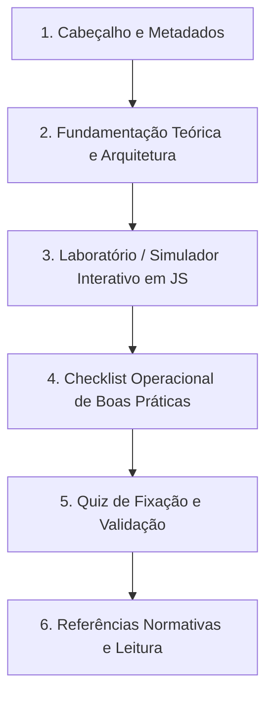

# Guia do Autor: Diretrizes Pedagógicas e Padrões de Conteúdo

Este documento estabelece as diretrizes de redação técnica, arquitetura de informação e padrões de código HTML/JS para a elaboração dos 28 módulos da plataforma **Estudos de Cibersegurança**.

---

## 1. Princípios Editoriais e Tom de Voz

1. **Linguagem Oficial:** Todo o conteúdo é redigido em **Português do Brasil (pt-BR)**.
   - Termos técnicos amplamente consagrados na indústria internacional podem ser mantidos no original em inglês, sempre acompanhados de explicação contextual no primeiro uso (ex.: *Least Privilege*, *Zero Trust Network Access (ZTNA)*, *Prompt Injection*, *Handshake*).
   - Siglas normativas (NIST, MITRE ATT&CK, ISO/IEC, RFC, OWASP, LGPD) devem ser explicitadas em sua primeira menção.
2. **Tom de Voz:**
   - **Pragmático e Operacional:** Escreva como um especialista sênior orientando um par ou liderado. Vá direto ao ponto.
   - **Didático e Rigoroso:** Cada afirmação técnica deve ser fundamentada em normas (NIST SP, ISO, RFCs) ou evidências empíricas de mercado.
   - **Livre de Floreios:** Evite introduções longas ou jargões vazios ("No mundo globalizado de hoje..."). Comece o módulo apresentando imediatamente o problema de segurança real e o que o estudante aprenderá a resolver.
3. **Público-Alvo:** Estudantes de tecnologia, analistas e engenheiros de segurança (Blue/Red/AppSec/GRC), operadores de SOC e candidatos a concursos públicos de alto nível e certificações profissionais (CompTIA Security+, CySA+, CEH, Pentest+, CISSP).

---

## 2. Estrutura Canônica de um Treinamento

Cada módulo é redigido em um arquivo fragmento `_geradores/<slug_snake_case>_body.html` e compilado pelo script `montar.py` para gerar `<Pasta>/treinamento-<slug_kebab_case>.html`.

Todo treinamento deve conter obrigatoriamente as 6 seções a seguir:



### Seção 1: Cabeçalho e Metadados (`.hero-header`)
- **Badge da Trilha:** Identificador visual da trilha com a respectiva cor temática.
- **Título do Estudo:** Direto e memorável.
- **Subtítulo Descritivo:** 1 a 2 frases resumindo a proposta de valor técnica.
- **Barra de Metadados:**
  - Tempo estimado de estudo (ex.: `⏱️ 40 minutos`).
  - Mapeamento NIST CSF 2.0 (ex.: `🛡️ NIST: Identify`).
  - Carreiras-alvo (ex.: `🎯 Blue Team | SOC | GRC`).

### Seção 2: Fundamentação Teórica e Arquitetura
- Explicação clara dos princípios, protocolos ou metodologias.
- Uso de diagramas conceituais (tabelas comparativas, fluxos).
- Destaque de boas práticas e armadilhas comuns através de caixas `.callout`.
- Exemplos de comandos e configurações reais através de blocos `.terminal-box`.

### Seção 3: Laboratório Prático / Simulador Interativo (`.lab-box`)
- Cada módulo **deve conter um simulador interativo em JavaScript puro (Vanilla JS)**.
- O simulador não é um mero elemento estético: ele deve permitir manipulação ativa pelo aluno (ex.: alterar parâmetros, acionar filtros, inspecionar pacotes, validar hashes).
- Não deve exigir requisições externas para funcionar — deve operar 100% offline.

### Seção 4: Checklist Operacional de Boas Práticas (`.checklist`)
- Lista de 4 a 8 itens práticos de verificação ou auditoria.
- Cada item utiliza caixas de seleção que persistem seu estado no `localStorage` do navegador via `initChecklist()`.
- O estudante deve conseguir utilizar esse checklist como modelo de trabalho real em suas auditorias corporativas.

### Seção 5: Quiz de Fixação e Validação (`.quiz-section`)
- No mínimo 3 a 4 questões de múltipla escolha com foco analítico (estilo casos de certificação ou concurso público).
- Cada opção de resposta deve oferecer feedback explicativo detalhado, justificando o porquê de estar correta ou incorreta.

### Seção 6: Referências Normativas e Leituras Complementares
- Lista concisa de padrões oficiais (links para RFCs, NIST SPs, guias CIS Benchmarks, artigos da OWASP ou documentações de fabricantes).

---

## 3. Componentes HTML e Padrões CSS do Design System

Todos os módulos utilizam as classes CSS padronizadas em `base.css`:

### 3.1 Caixas de Destaque (`.callout`)

```html
<!-- Dica operacional ou recomendação -->
<div class="callout callout-tip">
  <strong>💡 Dica Prática:</strong> Sempre desabilite o login direto de root no arquivo /etc/ssh/sshd_config.
</div>

<!-- Aviso importante de segurança -->
<div class="callout callout-warning">
  <strong>⚠️ Atenção:</strong> O uso de algoritmos legados como MD5 e SHA-1 não garante mais integridade contra colisões.
</div>

<!-- Alerta de perigo ou vulnerabilidade crítica -->
<div class="callout callout-danger">
  <strong>🚨 Perigo Crítico:</strong> Nunca desative a validação de certificados SSL/TLS em código de produção.
</div>

<!-- Requisito regulatório ou jurídico (LGPD, ISO) -->
<div class="callout callout-law">
  <strong>⚖️ Requisito Normativo:</strong> O art. 48 da LGPD exige a comunicação de incidentes relevantes à ANPD em prazo razoável.
</div>
```

### 3.2 Terminal de Comandos (`.terminal-box`)

```html
<div class="terminal-box">
  <div class="terminal-header">
    <span class="terminal-title">bash — inspeção de certificados</span>
    <button class="btn-copy" onclick="copyCode(this)">Copiar</button>
  </div>
  <pre><code>openssl x509 -in cert.pem -text -noout | grep "Validity" -A 2</code></pre>
</div>
```

### 3.3 Painel do Simulador Prático (`.lab-box`)

```html
<div class="lab-box">
  <div class="lab-header">
    <h3>🧪 Laboratório Interativo: Inspetor de Cabeçalhos</h3>
    <p>Altere os parâmetros do cabeçalho abaixo e observe a reação do host de destino.</p>
  </div>
  <div class="lab-body">
    <!-- Controles interativos -->
    <div class="lab-controls">
      <label>Porta Destino: <input type="number" id="labPort" value="443"></label>
      <button class="btn-primary" onclick="executarSimulacao()">Testar Conexão</button>
    </div>
    <!-- Área de saída -->
    <div class="lab-output" id="labResultado">
      Aguardando execução...
    </div>
  </div>
</div>
```

### 3.4 Lista de Verificação Interativa (`.checklist`)

```html
<div class="checklist" data-checklist-id="hardening-ssh">
  <h4>Checklist de Auditoria SSH</h4>
  <label class="check-item">
    <input type="checkbox" id="chk-ssh-root">
    <span>PermitRootLogin configurado explicitamente como 'no'</span>
  </label>
  <label class="check-item">
    <input type="checkbox" id="chk-ssh-pubkey">
    <span>PasswordAuthentication desabilitado em favor de chaves públicas</span>
  </label>
</div>
```

### 3.5 Quiz com Revelação Explicativa (`.quiz-item`)

```html
<div class="quiz-item" data-quiz-id="q1">
  <p class="quiz-question"><strong>Questão 1:</strong> Qual é a principal diferença entre um ataque de DoS e um DDoS?</p>
  <div class="quiz-options">
    <button class="quiz-btn" onclick="checkQuiz(this, false, 'Incorreto. O protocolo utilizado não é a distinção definidora.')">
      A) DoS usa UDP e DDoS usa apenas TCP.
    </button>
    <button class="quiz-btn" onclick="checkQuiz(this, true, 'Correto! No DDoS o tráfego se origina de múltiplos nós distribuídos.')">
      B) No DoS o ataque parte de uma única origem; no DDoS, de múltiplas origens distribuídas (botnet).
    </button>
  </div>
  <div class="quiz-feedback" style="display: none;"></div>
</div>
```

### 3.6 Diagramas Arquiteturais e Lógicos (`.diagram-box` e `<pre class="mermaid">`)

Para esquemas arquiteturais, fluxos de decisão e dissecção de protocolos, utilize a sintaxe canônica **Mermaid** encapsulada no container `.diagram-box`:

```html
<div class="diagram-box">
  <div class="diagram-header">
    <span class="diagram-title">Estrutura do Quadro Ethernet e Tag IEEE 802.1Q</span>
    <span class="diagram-badge">Mermaid</span>
  </div>
  <pre class="mermaid" data-title="Estrutura do Quadro Ethernet e Tag IEEE 802.1Q">
flowchart TD
    subgraph Quadro["Quadro Ethernet 802.3"]
        DMAC["MAC Destino<br><small>6 bytes</small>"]
        SMAC["MAC Origem<br><small>6 bytes</small>"]
        TAG["Tag 802.1Q<br><small>4 bytes (Opcional)</small>"]
        TP["EtherType<br><small>2 bytes</small>"]
        PAY["Payload de Dados<br><small>46 a 1500 bytes</small>"]
        FCS["FCS / CRC<br><small>4 bytes</small>"]
    end
    DMAC --> SMAC --> TAG --> TP --> PAY --> FCS
  </pre>
</div>
```

#### Boas Práticas de Diagramação:
1. **Orientação:** Prefira `flowchart TD` (vertical de cima para baixo) para hierarquias conceituais, árvores de decisão ou planos de controle e dados. Utilize `flowchart LR` (horizontal da esquerda para a direita) para pipelines e trajetórias lineares de pacotes.
2. **Nós Explicativos e Quebras de Linha:** Utilize `<br>` e `<small>` para adicionar legendas técnicas e tamanhos de campos sem alargar os nós desnecessariamente (ex.: `id["Policy Engine (PE)<br><small>Avaliação e Cálculo de Risco</small>"]`).
3. **Escapamento e Aspas Duplas:** Sempre envolva o texto dos nós entre aspas duplas: `node["Texto com (Parênteses)"]` para evitar erros de sintaxe no parser Mermaid.
4. **Agrupamento por Subgrafos:** Use `subgraph Nome["Título Visível"]` para isolar zonas de segurança (ex.: DMZ vs LAN), planos arquiteturais (Controle vs Dados) ou camadas da pilha OSI/TCP-IP.
5. **Responsividade Móvel:** Evite cadeias horizontais longas sem quebras; prefira fluxos em colunas ou em cascata que caibam confortavelmente em telas de 360px a 480px.

#### Pré-compilação Automática e Cache de SVGs:
- **Zero Runtime Externo:** A plataforma preserva o compromisso de **100% offline**. Nenhum arquivo JavaScript do Mermaid (`mermaid.min.js`) ou requisição CDN é executada no navegador do aluno.
- **Pipeline no `montar.py`:** Durante a compilação, o compilador detecta blocos `<pre class="mermaid">`, calcula o hash SHA-256 do código e busca o vetor SVG pré-renderizado em `_geradores/cache_diagramas/<hash>.svg`.
- **Injeção SVG Direta:** O bloco `<pre>` é substituído por `<div class="diagram-svg-wrap" role="img" aria-label="..."><svg>...</svg></div>`, com renderização vetorial cristalina em qualquer densidade de pixels.
- **Geração Automática via CLI:** Se um diagrama novo for criado ou um existente for editado, o compilador invoca `npx @mermaid-js/mermaid-cli` em Chromium headless com fundo transparente e tema escuro, persistindo o novo SVG no cache. Compilações subsequentes utilizam o cache instantaneamente sem necessidade de invocar o Node.js.

---

## 4. Diretrizes Técnicas para Simuladores em JavaScript

1. **Vanilla JavaScript Apenas:** Proibido o uso de frameworks externos (React, Vue, jQuery) ou bibliotecas de terceiros via CDN. Todo código deve ser executável nativamente em navegadores modernos.
2. **Web APIs Nativas Recomendadas:**
   - Criptografia: `window.crypto.subtle` (SHA-256, AES-GCM, HMAC).
   - Armazenamento: `window.localStorage` (com chaves prefixadas por `cs_`).
   - Manipulação de Texto e Bytes: `TextEncoder`, `TextDecoder`, `Uint8Array`.
3. **Prevenção de XSS nos Simuladores:**
   - Ao renderizar dados digitados pelo usuário, utilize sempre `element.textContent = valor` ou escape devidamente strings antes de concatená-las.
   - Em simuladores didáticos de injeção (ex.: lab de XSS), use elementos `iframe` com atributo `sandbox` ou sanitizadores visuais para evitar efeitos colaterais na própria página.
4. **Isolamento de Estado:**
   - Encapsule funções do simulador em escopos dedicados para evitar conflito de nomes de variáveis globais.
5. **Acessibilidade e Responsividade:**
   - Todos os inputs de formulário devem conter `<label>` associado ou atributo `aria-label`.
   - Layouts devem se adaptar sem quebras em larguras de tela de 360px a 1920px.

---

## 5. Convenções de Arquivos e Identificadores

1. **Nomes dos Slugs:** Utilizar formato Kebab-Case com iniciais maiúsculas nas palavras para o nome de pasta e slug canônico (ex.: `Fundamentos-Ciber`, `Redes-e-Protocolos`, `OWASP-Top-10-Web`).
2. **Nomes dos Arquivos de Entrada:** Salvos em `_geradores/` no formato `<slug_em_snake_case>_body.html` (ex.: `_geradores/fundamentos_ciber_body.html`).
3. **Nomes dos Arquivos de Saída:** Salvos na pasta do estudo no formato `<Pasta>/treinamento-<slug_em_kebab_case_minusculo>.html` (ex.: `Fundamentos-Ciber/treinamento-fundamentos-ciber.html`).
4. **Chaves de `localStorage`:**
   - Tema global: `cs_theme` (`light` | `dark`).
   - Checkboxes de estudos: `cs_check_<slug>_<item_id>`.
   - Status de conclusão de estudo: `cs_done_<slug>`.

---

## 6. Checklist de Qualidade Antes de Submeter um Novo Estudo

Antes de publicar ou compilar um novo estudo, confirme se todos os critérios abaixo foram atendidos:

- [ ] O slug e título constam exatamente como registrados em `_geradores/estudos.txt`.
- [ ] O arquivo `_geradores/<slug>_body.html` foi criado e contém as 6 seções obrigatórias.
- [ ] O simulador prático em JS funciona sem disparar erros no console do navegador (`F12`).
- [ ] Os checklists gravam o estado no `localStorage` e o restauram ao recarregar a página.
- [ ] Todas as questões do quiz possuem feedback pedagógico justificando as alternativas.
- [ ] Diagramas arquiteturais utilizam `<pre class="mermaid">` e compilam para SVG sem quebra visual.
- [ ] A compilação via `./_geradores/gerar.sh <slug>` executa com sucesso (`exit code 0`).
- [ ] O arquivo gerado funciona 100% offline via protocolo `file:///`.
